# Industrialized AI Short Drama End-to-End Pipeline & Per-Stage Prompt Engineering Specification (`PIPELINE_SPEC` v3.5 · Seedance 2.5 Deep Engineering Edition)

> **Core Philosophy**: Script-Driven Assets. Direct generative video diffusion models using professional cinema audiovisual language grounded in diffusion first-principles. Enforce strict engineering constraints to systematically eliminate "AI plastic look," frozen puppets, literal dyeing, robotic uniform pacing, motion melting, weightless floating, and identity drift across episodes.
>
> **Target Engine**: Fully adapted for **Seedance 2.5 (General Canvas / Web-Ready Instant-Paste Format)**, integrating the `dreamina-canvas` CLI and `jimeng-novel` local engineering toolchain.
>
> **Calibration Notice**: Values marked **[CALIBRATE]** are starting baselines. Confirm them in the pilot phase against official Seedance 2.5 benchmarks (reference limits, prompt length, shot duration) before locking this spec.

---

## 1. End-to-End 5-Stage Standard Production Workflow (Storyboard-First, Demand-Driven Assets)

```mermaid
flowchart LR
    S1["Stage 1: Script Diagnosis & Respiratory Breakdown<br/>(Subtext / Macro Cadence Wave)"] --> S3["Stage 2 (Storyboard-First): Director Shot Breakdown<br/>(EXX_master.md + EXX.md + Asset Demand Manifest)"]
    S3 --> S3V["Stage 2.5: Shot Syntax Lint & Pre-Flight Red Lines<br/>(audit_shots.py --skip-lock)"]
    S3V --> S2["Stage 3 (Demand-Driven): Asset Window Fulfills Manifest<br/>(CHR/SCN/PRP/LIT Codes / Clean Turnarounds / 720 Slices)"]
    S2 --> S2L["Stage 3.5: Triple SHA-256 Lock & Full Gate Pass<br/>(asset_lock.py lock + full audit_shots.py)"]
    S2L --> S4["Stage 4: Controlled Shot Generation<br/>(Mode A Relay / Mode B Multi-Ref / Kinetic Easing)"]
    S4 --> S4Q["Stage 4.5: Native-Resolution Shot QC<br/>(Pilot Gate / Relay Gate)"]
    S4Q --> S5["Stage 5: Audio Mastering, Lip-Sync Fallback & FFmpeg Assembly"]
```



> **Stage numbers**: Stage 2.5 is shot lint (`--skip-lock`) only. Stage 3.5 is the SHA-256 lock plus a full audit. Relay frames lock at Stage 4.5 / §8.2. Do not call the lock step Stage 2.5.

### 1.1 Mandatory Execution Rules

1. **Storyboard-First, Demand-Driven Assets, Lock Before Rolling**: For each episode, **[Window ③ Storyboard] first parses the script into complete shots plus an Episode Asset Demand Form (`shots/EXX_assets_todo.md`) and passes `--skip-lock` lint → [Window ② Assets] then inspects the form and generates only the missing required assets (zero guesswork, zero waste), checks them off, and runs triple SHA-256 locking → Full `audit_shots.py` green-lights Stage 4 pilot & video generation**. Never blind-roll pure T2V without locked assets.
2. **CLI Verbatim Passthrough & Instant-Paste Code Blocks**: `jimeng-novel --prompt-file <md>#<section>` submits the body of that `##` section **verbatim**, with no prefixes or suffixes. In Seedance 2.5 General Canvas / Web UI, prompts are enclosed in pure ```text ... ``` code blocks ready for single-click copy-paste. Submitted sections contain **pure execution prompts only**: zero comments, zero unresolved placeholders.
3. **Non-Destructive Asset Versioning**: CLI `--out` moves previous files into `old/`. Any local workflow overwriting a delivered file must archive the prior version first. Archived files are renamed `<original_name>_v<version>_<ISO_datetime>.<ext>` (e.g., `S07_v2_20261118T1430.mp4`). Version numbers are assigned automatically by the archiving step and never edited by hand.
4. **Cost Safety & Idempotency**: Run `credit estimate` before any billable generation. On a timeout or uncertain task state, only query `node result`. Never re-submit `node run` for a task whose state is unknown. Retry rules are in §10.
5. **Asset Lock (Stage 3.5)**: After the asset window fills the manifest, run `asset_lock.py lock --scope all`. This writes `cast/LOCKED.json`, `cast/frames/LOCKED_FRAMES.json`, `cast/blocking/LOCKED_BLOCKING.json`, and `cast/canon/CANON.json`. The full pre-flight verifies those hashes and stops on mismatch. Changing a locked asset requires **Change Request → Blast-Radius Assessment (shot `Deps` column, §2.3) → Re-Lock**. Relay frames lock in §8.2.
6. **Dialogue Audio Mode Is Declared Per Shot**: Every shot declares `audio_mode` in the Master Shot Table (§2.3): `native` or `vo_lipsync`. Definitions are in §2.4. Mixing them within one shot is prohibited.
7. **Unified Asset Generation Entry (General Canvas CLI + Zero-Credit Unlimited Loop)**: All image assets (character turnarounds, expression/state variants, scene plates, 720° panoramas, hero props, and Mode A first-frame pose plates) **strictly use the General AI Canvas CLI (`dreamina-canvas`, project binding specified in `README.md`) rather than the Drama Canvas**. Default zero-credit production loop: **(1) CLI creates/edits image nodes with spec-compliant prompts without `--run` (0 credits) → (2) User enables `0积分畅用` (0-credit unlimited) in the web canvas UI and triggers generation (0 credits) → (3) CLI pulls approved high-res outputs via `node show` + `resource download` into `cast/` or `cast/frames/` and locks via `asset_lock.py lock --scope all`**. Paid CLI `--run` execution is allowed only after explicit user quote confirmation.

---

## 1.2 Root-Cause Diagnosis from Diffusion First Principles

Addressing the 5 most common generative video failure modes by analyzing video diffusion mechanics and establishing counter-engineering measures:

### 1. Frozen Puppets and Dead World
- **Mechanism**: Temporal diffusion models denoise toward the most probable, temporally consistent solution. Static is the cheapest consistent latent state. Tokens with explicit motion verbs receive cross-attention weight; anything unmentioned falls back to the default "hold still." A speaking character carries the densest motion tokens, so attention concentrates there, while listeners and backgrounds inherit the frozen default.
- **Countermeasure: The Three-Layer Ambient Motion Budget & Listener Idle Library**:
  - **Foreground Idle**: Non-active principals receive physical idle behaviors (breathing in shoulders, thumb rubbing tools, weight shift, slow blink). Never write "listens" or "stands still."
  - **Midground**: Secondary people, props, steam, fabric flutter, falling sparks.
  - **Background**: Weather, light flicker, air particles (Tyndall dust motes).
  - Each layer gets at least one **continuous motion** (rain streaks, steam) and one **punctuated event** (water drip, passing shadow) to break looping artifacts.

### 2. Literal Dyeing & Text Broadcast Fallacy
- **Mechanism**: The text encoder binds color and state adjectives to the nearest noun and broadcasts them across the entire entity region. "Face turned red" paints the face red; "vision went black" drops the entire frame exposure to zero; "gritted teeth / cold sweat" retrieves exaggerated anime or horror tropes.
- **Countermeasure: The Physiological Translation Layer**:
  - Never write the idiom. Translate every emotion into three observable channels:
    1. **Physical Mechanism**: Small muscles, breath, gaze, posture.
    2. **Locality & Degree**: "Faint, uneven warmth high on the cheekbones and ear tips."
    3. **Preservation Clause**: "Natural skin tone unchanged elsewhere, no color grading shift."
  - Positive-only phrasing: Describe natural skin tone rather than "no red face" to prevent negative token injection.

### 3. Synchronized Hive-Mind
- **Mechanism**: A collective phrase ("the crowd bowed") conditions all instances of "person" with an identical motion signal, causing synchronized robotic movement.
- **Countermeasure: Screen Slotting & Staggered Onset**:
  - Ban collective verbs. Name up to 3 foreground slots by screen position ("man in gray cap, far left").
  - Assign distinct actions, **onset offsets (+0.0s, +0.8s, +1.6s)**, and different amplitudes.
  - Keep at least one person who reacts late or not at all to reflect natural human asymmetry.

### 4. Limb Melting, Missing Follow-Through & Walkie-Talkie Dialogue
- **Mechanism**: Too many simultaneous articulations in one clip cause latent space collapse. Describing an action only by its peak causes sudden starts and harsh truncations.
- **Countermeasure**:
  - **Action Budget**: Per 5 s, max 1 primary action, 1 secondary action, plus ambient motion only.
  - **Three-Beat Verbs**: Anticipation ➔ Action ➔ Settle with a stated terminal pose.
  - **Natural Dialogue**: Listener pre-reaction 0.5s before replying, slight pauses, and gaze breaks.

### 5. Floating Slideshow & Missing Cadence (Uniform Linear Velocity)
- **Mechanism**: Diffusion models default to linear mathematical interpolation across frames without explicit acceleration, yielding weightless, floaty slow motion. Furthermore, uniform shot lengths (e.g. 5-second metronome) suffocate emotional cadence.
- **Countermeasure: The Respiratory Kinetic Architecture**:
  - **Macro Cadence Wave (Inter-Shot Breathing Curve)**:
    - *Inhale (Suspense / Build)*: 4.0 to 6.0 s. Static or slow push, micro-actions, suffocating stillness.
    - *Exhale (Ignition / Burst)*: 1.5 to 3.0 s. Explosive velocity, concentrated impulse, 0 wasted frames.
    - *Hold (Aftermath / Resonance)*: 4.0 to 5.0 s. Settling dust, lingering breath, auditory vacuum.
  - **Micro Kinetics (Intra-Shot Non-Linear Easing)**:
    - Anticipation (0.5–0.8s micro-freeze or center-of-gravity drop) ➔ Explosive Burst ➔ Impact Lock & Follow-Through (abrupt kinetic stop with fabric/dust inertia damping to a settled rest).
  - **Dynamic Contrast**: Stationary character ➔ maximize environmental motion. Violent character motion ➔ lock camera to absolute axis.

---

## 2. Stage 1: Script Analysis & Cadence Wave Breakdown

### 2.1 Director Breakdown Table
Parse `scripts/EpisodeXX_*.md` by answering four questions per scene:
1. **Narrative Motivation**: Core information or suspense advanced.
2. **Cadence Beat Type**: Inhale (4-6s) / Exhale Burst (1.5-3s) / Hold (4-5s).
3. **Audiovisual Pivot**: Shot scale, elevation, foreground framing, lighting contrast.
4. **Asset Complexity Audit**: High-risk items requiring dedicated asset cards.

### 2.2 Dialogue Length Cap
- **Chinese**: writing target ≤ 8 characters; the linter rejects any line over 10 characters.
- **English**: ≤ 10 syllables per line. Max 2 short lines per shot.
- **Hold duration**: the hard band is 4.0–6.0s, same as Inhale. 4.0–5.0s is the preferred hold.

### 2.3 Master Shot Table Schema (`shots/EXX_master.md`)
13 columns, in this order: `Shot`, `Dur`, `Scene`, `Characters` (🎬/👂/❌), `Mode` (A/B), `Refs`, `Frame Status`, `Audio Mode`, `Emotion In → Out`, `Bridge`, `Cadence Beat`, `Deps`, `QC & Attempts`. Use a fullwidth `｜` inside a cell. An ASCII `|` shifts Cadence and Deps.

### 2.4 Audio Mode

| Value | Use when | Prompt |
| :--- | :--- | :--- |
| `native` | Seedance speaks the line and moves the mouth | Keep the quoted line and allow 角色人声 in the audio whitelist |
| `vo_lipsync` | An external voice track will be locked in Stage 5 | Mark `vo_lipsync`. Keep the 10-character cap. Lay the external track in Stage 5 |

---

## 3. Stage 2: Standard Asset Taxonomy & ID Architecture

**Core Principle: References own identity. Text owns behavior and deltas.**
Do not re-describe faces, hair, or outfits locked in references. Text carries only blocking, kinetics, micro-expressions, and deltas (mud, rain, blood).

| Asset Code | Purpose | Requirements | Path Example |
| :--- | :--- | :--- | :--- |
| **`CHR-<name>-TURN`** | Character Turnaround | Front, true side, back. **Hands empty and relaxed**, neutral pose, 16:9 studio gray | `cast/<name>.默认.png` |
| **`CHR-<name>-EXP`** | Expression Anchors | Structure and emotion without baked-in dyeing. Natural skin tone throughout | `cast/<name>.<emotion>.png` |
| **`CHR-<name>-STATE`** | Costume / Condition States | Rain-wet, mud, torn armor, derived directly from the base turnaround | `cast/<name>.<state>.png` |
| **`SCN-<place>-MASTER`** | Empty Scene Plate | Layout and lighting ground truth. **No people**, wide eye-level | `cast/<place>.默认.png` |
| **`SCN-<place>-GRID`** | Scene Multi-Angle 4-Grid | Pure 16:9 2x2 multi-angle sheet from 720 pano (**Zero text/annotations**; Reverse, Overhead, Left, Right) | `cast/<place>.多机位展板.png` |
| **`SCN-<place>-ANGLE-x`** | Reverse / Detail Angle | Cross-shot spatial consistency via 4-grid slicing or 720° pano extraction | `cast/<place>.机位_<name>.png` |
| **`SCN-<place>-MAP`** | Top-down Blocking Map | Spatial orientation, 180° axis (human inspection only) | `cast/storyboard/<place>.map.png` |
| **`PRP-<item>`** | Hero Prop Plate | Isolated on neutral ground, 2 angles, scale reference | `cast/<item>.默认.png` |
| **`LIT-<scene>`** | Light Reference | Color temperature, key light direction, mood | `cast/<place>.光影基调.png` |
| **`BLK-<EXX>-<SXX>`** | Spatial Blocking Plate | Color-coded matte mannequins fixing 3D camera, composition, depth, and spatial coordinates (§3.3) | `cast/blocking/EXX_SXX_blocking.png` |
| **`FRM-<EXX>-<SXX>`** | First Frame / Relay Frame | Mode A pose anchor or 100% lossless last frame from approved video | `cast/frames/EXX_SXX_first.png` |

**Rule P-1 (Scope Boundary)**: Only `cast/`, `cast/frames/`, and `cast/blocking/` are allowed as reference mounts to video diffusion models; `cast/storyboard/` is strictly for human inspection.
**Rule P-3 (One Source Per Character)**: Maximum 1 reference card per character per shot (variants replace the base turnaround; never mount both).

### 3.3 Color-Coded Mannequin Spatial Blocking System (`BLK-<EXX>-<SXX>`)

1. **Diffusion Spatial Grounding Mechanics (Minimalist 3D Whitebox Stage)**:
   When multiple characters share a frame or interact across complex axes, text-only prompts ("lead on the left, partner on the right") frequently suffer from spatial swapping, depth flattening, limb melting, or eye-line misalignment.
   **Prohibition on Realistic Backgrounds in Blocking Plates**: If the blocking plate contains realistic textures or scenery, it causes aggressive cross-attention feature competition with the master scene plate (`@Scene`), leading to background jitter and prop hallucinations.
   Therefore, the blocking plate utilizes a film-grade **Minimalist 3D Whitebox Stage (Clay Previs)**:
   - A clean, neutral light-gray 3D studio with a subtle perspective floor grid.
   - Simplified, untextured geometric clay bounding boxes representing basic furniture (e.g. a plain rectangular cube for a workbench, simple doorframe contours); zero realistic wallpaper, wood grain, or detailed set dressings.
   - Solid, matte, color-coded mannequins placed with anatomical scale, skeletal poses, depth occlusion, and gaze orientation.
   - Mannequins have **no facial features, no hair, and no detailed clothing**, preventing structural competition with the character cards.
   - Each mannequin uses a **fixed, solid color** mapped to a specific character: `@Blocking: the orange mannequin corresponds to @Lead, the blue mannequin corresponds to @Partner`.

2. **Character Color Codebook**:
   | Character | Solid Mannequin Color | Visual Role |
   | :--- | :--- | :--- |
   | **Lead** | **Solid Vibrant Orange Mannequin** | Young lean lead, signature costume color |
   | **Partner** | **Solid Navy Blue Mannequin** | Broad build, work clothes |
   | **Third lead** | **Solid Emerald Green Mannequin** | Agile build, light costume |
   | **Elder / antagonist** | **Solid Dark Ochre Mannequin** | Older, heavier stance |
   | **Extras / Background** | **Solid Light Gray Mannequin** | Secondary background staging |

3. **Three Pillars of Authority & Role-Limiting**:
   - **`@Scene` (Master Scene Plate)**: 100% sole authority over architectural layout, lighting mood, weather, and real surface textures.
   - **`@Blocking` (Whitebox Previs Plate)**: 100% sole authority over 3D camera geometry, depth layers, coordinates, and poses (ignore whitebox grid).
   - **`@Character` (Character Turnaround)**: 100% sole authority over authentic human facial features, skin pores, and clothing fabric.
   - **Constraint Clause (positive only)**: `The environment is rendered from the scene plate's real materials and light. Every person on screen has real human skin, pores, and cloth. The blocking plate contributes coordinates, perspective, and pose only.` Do not write "no mannequin" or "no plastic" in the prompt. Those tokens get recalled.

4. **Reference Slot Allocation (4-Slot Clean Closure)**:
   Under Seedance 2.5's **[CALIBRATE: 4]** reference limit, a two-character dramatic scene forms a complete 4-ref system:
   `@Scene` (1) + `@Blocking` (1) + `@CharacterA` (1) + `@CharacterB` (1) = **exactly 4 references**, totally decoupling scene truth from spatial blocking.

5. **Production & Locking Loop**:
   Window ③ specifies `BLK-<EXX>-<SXX>` in `shots/EXX_assets_todo.md` (via template 05), Window ② generates it on canvas via zero-credit mode into `cast/blocking/EXX_SXX_blocking.png`, and locks via `python tools/asset_lock.py lock --scope blocking`.

### 3.4 Scene Multi-Angle System: 720° VR Panorama Virtual Extraction (Banning 2D Text Multi-Grid)

1. **Diffusion Mechanics & Failure Mode Diagnosis (Why 2D Text Multi-Grids Always Fail)**:
   2D diffusion models lack an internal 3D scene representation. Text prompts specifying 4 angles in one grid produce **4 independent, contradictory rooms** (doors, windows, and tables mismatch).
   **[Red-Line Ban] Never prompt 2D models directly for a multi-grid scene.**

2. **The Ground-Truth Solution: [Master Plate ➔ 720° Panorama ➔ `pano_to_grid.py` / `extract_pano.py`]**:
   - Generate a true closed 360°×180° equirectangular sphere on canvas (`SCN-*-PANO` · `cast/<place>.全景720.png`).
   - Run the automated local projection tool (`python 02_规范与工具/tools/pano_to_grid.py --input cast/<place>.全景720.png`) to extract all 4 camera angles mathematically within 2 seconds:
     - **Clean 4-Grid Overview (`cast/<place>.多机位展板.png`)**: **[Ironclad Rule] Absolutely NO text labels, watermarks, or overlay boxes on the grid sheet.** Kept 100% clean to avoid downstream diffusion feature pollution.
     - **Reverse Angle (`cast/<place>.机位_反打.png`)**: `--yaw 180 --pitch 0` (looking back toward entrance).
     - **Top-Down Angle (`cast/<place>.机位_俯视.png`)**: `--yaw 0 --pitch -50 --fov 90` (overhead bird's-eye view).
     - **Left Side Angle (`cast/<place>.机位_左侧.png`)**: `--yaw -90 --pitch 0` (left wall / rain window).
     - **Right Side Angle (`cast/<place>.机位_右侧.png`)**: `--yaw 90 --pitch 0` (right wall / shelves).
   - Lock slices via `python tools/asset_lock.py lock --scope cast`. Mount the extracted slice cards directly in Mode B shots for 100% perfect cross-shot spatial consistency.

---

## 4. Prompt Anatomy: The 8 Compensatory Layers

Every Seedance 2.5 prompt is organized into 8 layers:
1. **REFERENCES**: Asset IDs mapped to strict role-limiting boundaries (identity only / layout only / prop only).
2. **SHOT**: Size, elevation, lens feel, ONE camera move, duration.
3. **BLOCKING**: Positions, facing directions, absolute gaze targets, spacing and depth layers.
4. **TIMELINE**: Second-by-second beats with Anticipation ➔ Burst ➔ Impact Lock & Follow-Through with stated terminal pose.
5. **AMBIENT MOTION BUDGET**: Foreground idle (listener physical behavior), Midground (props/steam/cloth), Background (weather/dust).
6. **DIALOGUE**: Speaker, line (≤8–10 chars), timing, listener pre-reaction, natural gap/overlap.
7. **LIGHT AND COLOR**: Motivated light direction + facial skin-tone preservation clause.
8. **HANDOFF & CONSTRAINTS**: Continuity handoff to next shot; diegetic sound effects `<SFX>`; non-speaking lock clause.

---

## 5. The 15 Anti-AI Rules & Reference Dictionaries

### 5.1 Physiological Translation Table (Combats Literal Dyeing)
- **Blush / Flushed**: Faint, uneven warmth high on cheekbones and ear tips, building slowly. Natural skin tone elsewhere unchanged, no color grading shift. Gaze drops, chin tucks slightly.
- **Pale with Fear**: Face stills, blink rate drops, lips press thin, breath held then shallow. Natural skin tone and lighting unchanged.
- **Vision Went Black / Dizziness**: Slow long blink, background focus drifts soft, hand reaches to brace nearest sturdy surface, center of gravity wobbles then locks. Exposure unchanged.
- **Gnashing Teeth**: Jaw muscle tightens with visible bulge at the hinge, lips stay naturally pressed closed, nostrils flare slightly. Mouth structure natural.
- **Cold Sweat**: Single faint sheen at temple catching key light, subtle swallow. Skin texture clean.
- **Heart Sank**: Shoulders drop two centimeters, slow nasal exhale, eyes unfocus downward.
- **Trembling with Rage**: Fine tremor in fingers only, knuckles whiten slightly at grip, voice low and steady, shoulders locked solid.

### 5.2 Kinetic Dynamics & Easing Table (Combats Weightless Floating)
- **Sudden Grab**: Fingers pause at pocket hem for 0.5s (anticipation), then hand snaps forward with sudden momentum, clamping onto surface with an abrupt impact lock; sleeve cuff slides forward and settles.
- **Head Turn**: Holds gaze straight for half a beat (anticipation), then snaps head abruptly toward off-frame target; ear tips and hair tufts overshoot slightly before snapping into a locked, steady stare.
- **Rising / Standing Up**: Braces palms flat on table, leans torso forward lowering center of gravity (anticipation), pushes up with an explosive upward thrust, rising tall; coat tails swing forward in inertia, then sway to rest.
- **Slam / Strike**: Lifts forearm with suspended hesitation (anticipation), then drives fist down in high velocity; knuckles strike wood with sharp impact lock; surrounding dust motes puff outward.
- **Sudden Freeze**: Mid-movement, hand instantly arrests with visible muscular tension; breath cuts off mid-inhalation, shoulders locking rigid while small pendants continue faint residual sway.

---

## 6. Seedance 2.5 Production Prompt Templates

### 6.1 Mode B Template (Multi-Reference with `@Alias`)
````markdown
## S01
- **Parameters**: `Seedance 2.5` | `Mode B (Multi-Ref)` | `16:9` | `4.0s` | `Audio: native` | `Cadence: Inhale`
- **Mount Refs (≤4)**: `@Workshop`=`cast/Workshop.angle_desk.png` | `@CharacterA`=`cast/CharacterA.默认.png`

```text
国漫3D（CG）写实高精度风格，电影级光影质感，顶级3D动漫电影渲染级别，真实物理材质与自然微瑕疵纹理，强明暗情绪反差，浅景深与空气介质微尘感。

参考映射：@Workshop 为场景空间与布光基准（仅环境）；@CharacterA 为角色面部与服饰基准（仅外貌，非姿态）。
本片段设定在 @Workshop。桌面散落钟表零件与冷光油污，窗外暴雨如注。整体基调：暖黄工作台吊灯与冷蓝窗外雷雨形成强烈冷暖对冲，中景微弱景深虚化。

拍子1（0.0–2.0秒）：中景单人视点，机位固定静止。@CharacterA 位于画面左侧台前，侧身面朝右侧工作台，视线死死聚焦在桌面的微型游丝齿轮上；双手手掌平平撑在木桌边缘，上身微向前倾压低质心（蓄力），指节因用力而微弱泛白；深色工装围裙边缘带着真实机油折痕。角色胸膛微弱起伏呼吸，全程保持专注待机。窗外暴雨沿窗玻璃不规则流淌，吊灯光柱中悬浮细微尘埃。<工作台零件轻微金属碰撞声与窗外沉闷雷雨声>
拍子2（2.0–4.0秒）：画面平滑微距推进。@CharacterA 猛然直起身躯，双臂向上挺起站立，围裙系带因惯性向前甩动随后回落服帖（终态锁死）；神情凝固，开口低沉说道：「零件全被动过了。」面部颧骨处保持自然微黄肤色，无调色漂移。<木桌受力摩擦声与低沉叹气声>

音轨仅保留角色人声、环境声与物理动作音效；画面中所有出镜角色动作稳定自然。不要生成旁白字幕、台词字幕或对白字幕。
衔接：角色A站立于桌前，右手仍按在台面边缘。
```
````

### 6.2 Mode A Template (First-Frame I2V Relay)
````markdown
## S04
- **Parameters**: `Seedance 2.5` | `Mode A (First-Frame I2V)` | `16:9` | `2.5s` | `Audio: native` | `Cadence: Exhale (Burst)`
- **Mount First Frame**: `首帧`=`cast/frames/E01_S04_first.png`

```text
国漫3D（CG）写实高精度风格，电影级光影质感，顶级3D动漫电影渲染级别，真实物理材质与自然微瑕疵纹理，强明暗情绪反差，浅景深与空气介质微尘感。

紧接首帧画面直接延续动作。泥泞林地，暴雨如注，空气中弥漫飞溅雨雾与湿冷水汽。
拍子1（0.0–1.2秒）：低机位仰角仰视，机位绝对固定锁死。主角 维持首帧右腿弓步起势，脚下泥浆飞溅；双臂将长矛以极高加速度向前迅猛平刺破空而出，矛杆保持笔直刚性，红羽饰因惯性向后紧绷拉直。<矛尖破风锐啸声与脚下泥泞踩踏飞溅声>
拍子2（1.2–2.5秒）：矛尖猛烈凿入粗糙树干，双臂惯性前送并在伸直位骤然冲击锁死（终态姿态完全定住）；上衣布料在紧绷状态下骤停，衣摆因余震轻微向前颤动两次后落定服帖。树干震落大片雨水与松针。<沉重钝响撞击声与密集落叶水滴声>

画面中所有出镜角色全程不说话。音轨仅保留环境声与物理动作音效。不要生成旁白字幕、台词字幕或对白字幕。
衔接：主角双手紧握矛杆维持刺入锁死姿势，胸膛剧烈喘息。
```
````

---

## Appendix A: Pre-Flight Checklist (17 automatic + 1 manual)

`audit_shots.py` enforces every item except item 8. Item 8 is judged by eye at the §8.1 pilot gate.

1. **No Camera Words**: No `camera`, `lens`, or `镜头`.
2. **Zero Unresolved Placeholders**: No `{{...}}` or `<<...>>`. Angle brackets `<diegetic sfx>` are required, not banned.
3. **Mode B `@Alias` Closure**: Header, master Refs, and body aliases match.
4. **Mode A Purity**: First frame only, no `@Alias`, continuation sentence present.
5. **Mode Exclusion**: A shot does not carry both a first frame and multi-ref images.
6. **Storyboard Scope Isolation**: No `storyboard/` or `.director.` paths.
7. **Beat Continuity**: Beats abut, sum to master Dur, and the duration sits in 1.5–3.0s or 4.0–6.0s.
8. **Action Budget (manual)**: One primary action per beat; combat or dash ≤ 2.0s. Not regex-checked.
9. **Dialogue Cap**: ≤ 10 Chinese characters. Writing target is 8.
10. **Silent Shot Lock**: Non-dialogue shots include 「全程不说话」 and do not whitelist 角色人声.
11. **Diegetic Sound**: Every beat contains one `<sfx>` tag.
12. **Gaze Anchor**: No 正视前方, 直视前方, 看向观众, 面向正前方, or 看着对方.
13. **Physiological Translation**: No 暴怒, 极度震惊, 嚎叫, 脸红, 眼前发黑.
14. **Diegetic Audio**: No `BGM`, `背景音乐`, `配乐`, `music`, or `score`. Show-specific bans belong in that show's README.
15. **No Exclusion Spam**: No default `Exclusions: 文字, 水印, 边框`. Every shot must still end with the verbatim line `不要生成旁白字幕、台词字幕或对白字幕。` Quoted speech stays in the mouth and the soundtrack. Burned-in captions are added later as `EXX.srt` if the cut needs them.
16. **Presence Marks**: Characters cell contains 🎬, 👂, or ❌, and never ⚠️. A missing person is still a human check.
17. **Cadence Wave**: At 3 shots, durations may not be identical. At 4 shots, both the short band and the long band must appear. Cadence labels must match Dur.
18. **Lock And Files**: Without `--skip-lock`, verify SHA-256 for `cast/`, `cast/frames/`, `cast/blocking/`, and `cast/canon/`, and require every mounted png to exist on disk.
