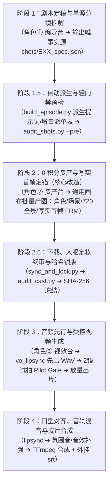

# AI 短剧工业化全流程重构规范与模板总集（`PIPELINE_SPEC v4.0`）

> **版本定位**：面向 **Seedance 2.5 + Seedream 5.5 + 即梦 0 积分通用画布** 的影视工业级 3D AIGC 短剧生产管线重构版。
> **核心理念**：**首帧定锚（Image-First）· 信号提纯（Signal-Only）· 单源驱动（SSOT）· 音画分轨（Audio-First）**。
> 本规范基于对 `v3.5` 架构的底层扩散机理复盘，推翻了“彩色白模直喂视频模型”“400–600字防御式长提示词”及“5窗口手工传表”三大核心瓶颈，可直接作为项目新基线文档与自动化脚本改造蓝本落地执行。

---

## 一、 架构诊断：为什么 `v3.5` 会出废片？（推翻与减法清单）

在视频扩散模型（DiT 架构，如 Seedance 2.5）的实际推理中，`v3.5` 暴露出的不稳定产出并非“执行不够严格”，而是**部分工程设计违背了扩散模型的底层注意力机制**。以下是 `v4.0` 推翻与重构的 6 大根因：

| 痛点维度 | `v3.5` 原方案的底层缺陷 | `v4.0` 架构级重构方案 |
| :--- | :--- | :--- |
| **1. 提示词过长与注意力稀释** | 单镜 400–600 字，充斥重复画风句、三权解耦声明与“衔接”元信息。DiT 文本编码器前段权重最高，中后段动作与台词被严重稀释；且写“无调色漂移 / 浅灰网格留在参考图里”会触发**粉红大象效应**（提及即激活对应视觉 Token）。 | **信号提纯 4 段式骨架（120–200 字，硬上限 240 字）**：视频 Prompt 砍掉冗长画风前缀与防御性废话，移除 `衔接` 至卡头元数据，只保留纯正向视觉与动作信号。 |
| **2. 彩色白模染色与塑料质感** | 将高饱和亮橙/深蓝哑光人偶图直接作为 Mode B 参考图喂给视频模型。VAE 视觉潜变量携带极强的色块与塑料高光能量，文本解耦根本压不住视觉特征渗透。 | **推翻“白模直喂视频”！升级为“0 积分首帧定锚（Mode A 主力制）”**：用 Seedream 5.5 在 0 积分画布合成 100% 写实首帧 `FRM`，视频阶段仅喂该首帧；构图复杂时仅在生图阶段使用**黑白灰线稿/火柴人骨架**，彻底断绝染色。 |
| **3. 720° 全景切片遇大运镜僵硬** | 静态四机位切片仅锁死单视角，遇到 180° 环绕、甩镜或高速追逐时，单张静态参考图会和运镜向量打架，导致墙体扭曲或动作卡顿。 | **动态运镜三阶路由**：① 静态/缓推用单首帧；② 大摇移/环绕用**全景双切片→首尾双帧（Start+End I2V）**硬锚空间；③ 追逐打斗用 **1.5–2.5s 动能接力切镜**。 |
| **4. 过度工程化规则反噬产出** | 强制每镜三层环境动态+突发事件、强制 3 人按 `+0.8s/+1.6s` 错峰、硬禁 `3.1–3.9s` 时长、每拍强塞 `<物理音效>`——模型没有毫秒级多主体时钟，规则互相打架导致画面杂乱。 | **做减法**：16 条红线精简为 **8 条高信号导演硬规**；删去毫秒错峰与强制 3 层环境预算（仅长拍启用）；时长对齐模型原生甜点档（`2s / 3s / 4s / 5s`）。 |
| **5. 5 窗口手工传表摩擦力大** | `EXX_master.md`、`EXX.md`、`EXX_assets_todo.md` 三份文件分离维护，人脑在 5 个窗口间反复复制粘贴，极易漏改、版本漂移。 | **单源事实（SSOT）+ 3 角色合并**：分镜只维护一份 `shots/EXX_spec.json`，由脚本自动派生总控表、提示词集与增量派单队列，CLI 一键批量建节点。 |
| **6. 台词口型提前闭合或语速过急** | 仅粗略限制“单句 ≤10 字”，未计入起收口呼吸气口耗时，且 `vo_lipsync` 在出片后再硬凑配音，导致音画时长错位。 | **气口字数公式 + 音频先行（Audio-First）**：确立 `Max_Chars = floor((Dur - 0.8) × Rate)`；主角特写与连续对白强制先出配音 WAV，再按音频实测时长反推视频帧长。 |

---

## 二、 端到端 4 阶段工业化工作流（`v4.0`）



### 2.1 角色与目录权责收敛（5 窗口 ➔ 3 角色）

原 5 窗口中“规范总控”日常低频，“剧本”与“分镜”天然强耦合。`v4.0` 收敛为 **3 大核心工种角色**（规范脚本作为只读基础设施由仓库版本管理维护）：

| 角色窗口 | 专属写入目录 | 核心职责与唯一交付物 | 核心红线 |
| :--- | :--- | :--- | :--- |
| **角色①：编剧与导演分镜台** | `01_故事与剧本/`, `shots/` | 剧本定稿；拆解并维护单集唯一事实源 `shots/EXX_spec.json`；运行 `build_episode.py` 自动生成可读表、提示词与缺口派单表。 | 严禁手工直接编辑派生文件（`EXX_master.md` / `EXX_prompts.md`）；单镜视频 Prompt 严禁超 240 字。 |
| **角色②：资产与首帧工坊** | `cast/`（含 `frames/`, `sketch/`, `canon/`） | 按增量派单表 `EXX_assets_todo.json` 跑 CLI 一键推送至 0 积分画布；批量生成纯角色卡、场景/全景切片、**写实首尾帧 `FRM`**；执行 `sync_and_lock.py` 锁版。 | 严禁向视频模型投喂彩色白模图；角色基础三视图严禁带外挂武器/背包；严禁静默覆盖已锁版哈希。 |
| **角色③：视频与后期合成台** | `out/`, `audio/`（仅抽无损末帧入 `cast/frames/`） | `vo_lipsync` 镜头先出配音 WAV 反锁时长；执行 2 镜试拍卡点；放量生成视频；执行口型同步与 FFmpeg 合成；只追加写入 `RUNLOG.md`。 | 资产未锁版严禁开拍；单镜最多 3 次尝试（每次仅改 1 变量）；单集达 80% 积分预算强制熔断。 |

---

## 三、 核心技术重构：视觉控制与运镜体系

### 3.1 彻底废除“彩色白模直喂视频”，推行“首帧定锚制（Image-First）”

**底层原则**：让 **0 积分的图片模型（Seedream 5.5）** 承担 100% 的构图、透视、人物长相、服装纹理与光影对齐工作；让 **昂贵的视频模型（Seedance 2.5）** 只专注做一件事——**物理运动与表演**。

| 视频生成模式 | 适用占比 | 参考图挂载规范 | 适用场景 | 核心优势 |
| :--- | :--- | :--- | :--- | :--- |
| **Mode A（单首帧 I2V · 主力）** | **65–75%** | 仅挂 1 张写实首帧 `cast/frames/EXX_SXX_first.png` | 绝大多数对话、微表情、动作起势、固定/缓推/微摇镜头 | 彻底消除多图特征打架、白模染色与塑料感；首帧可在 0 积分画布无限免费抽到完美再花视频积分。 |
| **Mode A+（首尾双帧 I2V · 运镜利器）** | **15–20%** | 挂 2 张写实帧：`first.png` + `last.png` | 大幅度推拉摇移、90°–180° 环绕运镜、明确起止姿态的复杂动作 | 用 720° 全景切出起止两机位，各渲染 0 积分写实帧作为首尾锚点，空间透视 100% 不飘移。 |
| **Mode B（轻量多参 · 仅作补充）** | **≤10%** | 最多 3 张：`@场景` + `@角色A`（+ `@角色B`），**严禁挂载任何白模/站位图** | 首帧角色背对画面、后半段需大幅转身露出正脸，且无法用首尾双帧解决的镜头 | 避免 4 图过载与白模污染，仅在必要时提供正脸身份锚点。 |

### 3.2 复杂站位的替代方案：仅限生图阶段使用的“无色线稿参考（Sketch）”

当某镜存在 2–3 人复杂景深站位，直接用文字在 Seedream 5.5 里拼不出理想写实首帧时：
1. **资产类型替换**：废除高饱和彩色塑料人偶 `BLK`，改用 **纯白底黑线极简构图草图 / 灰阶骨骼火柴人（`SKT-EXX-SXX` · `cast/sketch/EXX_SXX_sketch.png`）**，人物仅用极简几何线条与轮廓标出大小、前后遮挡与朝向，**零彩色、零塑料高光、零文字标注**；
2. **严格作用域隔离**：`cast/sketch/` 仅用于**角色② 在 0 积分画布中生成写实首帧 `FRM`**，作为中间构图辅助；**严禁将任何 `sketch/` 图片挂载给视频模型 Seedance 2.5**。

### 3.3 720° 全景切片与动态运镜三阶解法

保留 `v3.5` 极有价值的 **720° 球形全景 + `pano_to_grid.py` 数学切片体系**，并补齐其大动态运镜短板：

1. **一阶（静机 / 缓推 / 呼吸微摇）**：从 `全景720.png` 按精确角度切出单张背景底图 (`--yaw X --pitch Y --fov Z`) ➔ 0 积分画布合成角色与背景为写实首帧 `FRM` ➔ **Mode A 单首帧出片**。
2. **二阶（大摇镜 / 90°–180° 环绕 / 甩镜转场）**：从 `全景720.png` 分别切出起始视角（如 `--yaw 0`）与终止视角（如 `--yaw 120`）➔ 0 积分画布分别合成 `FRM_first.png` 与 `FRM_last.png` ➔ **Mode A+ 首尾双帧出片**，视频模型自动完成平滑三维空间插值。
3. **三阶（高速追逐 / 近身打斗 / 穿梭运镜）**：放弃长镜头一镜到底，拆解为 **1.5–2.5s 动能接力切镜（Kinetic Relay Cuts）**：
   - 每镜只执行 **1 个单一方向动能**（如：镜1 侧跟疾跑 2.0s ➔ 镜2 低角跨跃障碍 2.0s ➔ 镜3 急停刹车特写 2.0s）；
   - 同机位顺接用 `extract_last_frame.py` 无损抽末帧接力；换机位则在动作峰值处硬切（Cut on Action），符合商业短剧快节奏剪辑语法且大幅降低穿模率。

---

## 四、 提示词工程重构：高信号轻量骨架（根治注意力稀释）

### 4.1 视频提示词黄金 4 段式结构（目标 120–200 字，硬上限 240 字）

**核心原则**：
- **删掉 65 字通用画风前缀**：写实 3D CG 质感已由首帧 `FRM` 或参考图直接锁定，视频 Prompt 最多保留 8 字以内质地微调（如需要），不占前段核心注意力。
- **删掉所有“粉红大象”防御句**：不写“不要塑料感”“无调色漂移”“浅灰网格留在参考图里”“动作稳定自然”。
- **剥离元数据**：`衔接状态`、`情绪进出` 全部移出代码块，写在卡头元数据或 JSON 中。
- **单镜最多 2 拍**：2–3 秒镜只写 1 拍；4–5 秒镜最多 2 拍。

```text
[1. 景别与运镜（10–15字）] + [2. 环境与主光微锚（15–25字，Mode A 可极简）]
[3. 时序动作、微表情与对白（80–130字，1–2拍，纯物理动词 + 必要<物理音效>）]
[4. 极简尾注（12–20字）：无对话镜写“全程无对话，仅环境与动作音效，无字幕。”；有对话镜写“仅人声与环境音效，无字幕。”]
```

### 4.2 精简版 8 条导演级硬规（从 16 条瘦身，条条可被模型执行）

1. **视线必须落于实物或明确方位**：禁写“看着对方 / 正视前方 / 看向观众”，改为“视线紧盯桌沿扳手 / 眼神扫向右侧窗外”。
2. **纯物理微表情替代成语与染色词**：严禁“脸红 / 脸色惨白 / 眼前发黑 / 暴怒 / 咬牙切齿”，改用下方 8–18 字精简物理词典，**不附带冗长肤色保真废话**。
3. **手部绑定实物与单拍单主动作**：手部必须触碰工具、衣角、桌面或自身；2–3s 短拍仅做 1 个主动作，4–5s 长拍最多 1 主动作 + 1 次动作。
4. **非线性三拍爆发（蓄力 ➔ 冲量 ➔ 锁死回弹）**：爆发动作必须写清起点蓄力与终点刹停惯性（如发梢/衣摆晃动回落），消除匀速漂浮感。
5. **分档环境动态预算（取消一刀切）**：
   - **长拍 / 对话 / 建立镜（4–5s）**：写 1 项听者微动作（呼吸/轻叩指尖）+ 1 项环境介质流动（雨丝/微尘/光影闪烁），破除冰冻木偶；
   - **短拍 / 爆发动作镜（2–3s）**：环境只留 1 个极简动态词（如“暴雨斜飞”），将注意力 90% 留给主体动作。
6. **多人因果错峰（取消毫秒计时）**：单镜活跃动作者 ≤2 人，用“A先……紧接着B……”或“右侧人物微微一滞”打破蜂群同步，不再写模型听不懂的 `+0.8s/+1.6s`。
7. **时长对齐模型甜点与节奏呼吸**：单镜时长采用模型稳定档位（`2.0s / 2.5s / 3.0s / 4.0s / 5.0s`），每 4 镜内必须形成短拍（≤3.0s）与长拍（≥4.0s）的交替呼吸，同时严格服务首集强钩子节奏。
8. **声源纯净与零烧录字幕**：严禁出现 `BGM / 配乐 / music / score`；每镜末尾用极短正向/单句约束“无字幕”，成片字幕统一由后期外挂 `srt`。

### 4.3 精简版物理表演与动力学微词典（8–18 字高密度版）

| 剧本意图 | 严禁写法（染色/抽象/失重） | `v4.0` 高信号精简写法（直接粘贴，零废话） |
| :--- | :--- | :--- |
| **害羞 / 尴尬** | 脸红了、涨红了脸 | 耳尖微泛淡红，眼神骤然下垂，下颌微收。 |
| **恐惧 / 惊骇** | 脸色惨白、极度震惊 | 动作骤然僵停，双唇紧抿，鼻翼微张屏息。 |
| **眩晕 / 虚脱** | 眼前一黑、头晕目眩 | 眼皮沉重慢眨，单手急撑桌沿，肩背微晃稳住。 |
| **克制暴怒** | 暴怒、咬牙切齿、浑身发抖 | 下颌咬肌骤然绷紧，右手五指扣紧桌沿指节发白。 |
| **绝望 / 心沉** | 心沉谷底、痛不欲生 | 双肩微塌两厘米，鼻腔长呼一口气，眼神失焦下移。 |
| **热泪盈眶** | 泪流满面、号啕大哭 | 下眼睑泛起微弱水光，慢眨一次，一滴泪悬于睫毛未落。 |
| **骤然抓取** | 伸手抓起桌上的票据 | 指尖微顿蓄力，右手疾探扣死票据骤停，袖口惯性前滑后回落。 |
| **猛烈回头** | 转过头看向她 | 头部猛然甩向右侧画外，发梢惯性外扬后迅速回弹锁死。 |
| **霍然起身** | 从椅子上站起来 | 双手撑桌微前倾蓄力，腰腹爆发拔直站起，衣摆前甩两下渐止。 |
| **重击拍桌** | 挥拳砸在桌子上 | 右拳高抬微顿，垂直猛砸木面瞬间锁死，台面浮尘震起。 |

---

## 五、 音频、台词字数公式与口型对齐规程（Audio-First）

### 5.1 精确台词时长与气口公式

视频生成时，角色张嘴起势与闭嘴收尾需要固定生理缓冲（**起口 0.4s + 收口 0.4s = 0.8s**）。中文戏剧正常语速为 **3.5–4.5 字/秒**（急促情绪可达 5 字/秒，沉重慢读约 2.5–3 字/秒）。

$$\text{安全字数上限} = \lfloor (\text{镜头时长} - 0.8) \times \text{语速} \rfloor$$

| 镜头时长（模型档位） | 慢速/深沉（3字/秒） | 正常对话（4字/秒） | 急促/爆发（5字/秒） | 适用台词类型 |
| :--- | :--- | :--- | :--- | :--- |
| **`2.0s`** | 3 字 | 4–5 字 | 5–6 字 | 惊呼、喝止、单反应词（“站住！”“别动！”） |
| **`3.0s`** | 6 字 | 8–9 字 | 10–11 字 | 干脆短句、反问（“零件全被动过了。”） |
| **`4.0s`** | 9 字 | 12–13 字 | 14–15 字 | 完整信息句或含 0.3s 顿挫的双短句 |
| **`5.0s`** | 12 字 | 15–16 字 | 18 字（慎用） | 含听者先反应 0.5s + 说话人开口的完整交互拍 |

> **爆破音与气口修正**：台词中每包含 1 个明显逗号/停顿（`、` `，` `……`），总安全字数需扣减 **1.5 字**；长元音/呐喊尾音需额外预留 **0.5s**。

### 5.2 三轨音频路由决策树（`sfx_only` / `native` / `vo_lipsync`）

| 音频模式 | 适用镜头类型 | 核心执行流 |
| :--- | :--- | :--- |
| **`sfx_only`** | 空镜、纯打斗、无台词微表情 | 视频 Prompt 尾注写“全程无对话，仅环境与动作音效，无字幕。”；后期叠加干净氛围音与精准拟音。 |
| **`native`** | ≤3.0s 短叹词/呐喊、中远景/侧脸/过肩镜头、非核心龙套 | 由 Seedance 2.5 直接生成同步人声与口型，保留呼吸/喘息原生质感，效率最高。 |
| **`vo_lipsync`（音频先行）** | **主角近景/特写台词、连续多镜对白、全剧音色强锁定镜头** | **倒置工序**：① 先用固定音色 TTS/配音生成 `audio/EXX_SXX.wav` 并测出精确时长 $T$ ➔ ② 设定视频时长为 $\lceil T + 0.6\text{s} \rceil$ ➔ ③ 视频 Prompt 仅写表情、呼吸与肢体表演，**不写台词原文**（写“全程闭口微呼吸/神情凝重，无对话”）➔ ④ 成片后用专业对口型工具将 WAV 驱动至视频画面。彻底根除音色漂移、语速错乱与口型提前闭合！ |

---

## 六、 单源事实（SSOT）与多窗口自动化调度

为消除 5 窗口手工复制粘贴的漏错，`v4.0` 要求每集只维护 **1 份结构化清单 `shots/EXX_spec.json`**，配套 3 个轻量 Python 调度脚本打通全链路：

1. **`build_episode.py --ep E01`（一键派生）**：
   - 读取 `shots/E01_spec.json`；
   - 自动生成人类可读总控表 `shots/E01_master.md` 与纯复制粘贴版 `shots/E01_prompts.md`；
   - 自动比对 `cast/LOCKED.json`、`cast/frames/LOCKED_FRAMES.json`，过滤掉已存在且锁版的资产，输出**纯增量缺口派单表 `shots/E01_assets_todo.json`**（包含缺失的角色卡、场景切片、写实首尾帧）。
2. **`dispatch_canvas.py --todo shots/E01_assets_todo.json`（一键推画布）**：
   - 自动调用 `dreamina-canvas` CLI，将缺口资产的提示词与参考图挂载关系批量建好节点（不带 `--run`，0 积分）；
   - 人工只需打开网页端，开启「0积分畅用」，批量点击生成并挑图。
3. **`sync_and_lock.py --ep E01`（一键回库锁版）**：
   - 批量下载挑中的资产入库对应目录，自动运行 `audit_cast.py` 校验规格与无文字水印，通过后自动更新 SHA-256 哈希锁文件。

---

## 七、 `v4.0` 全套标准模板（Templates 01 ~ 05）

> **模板使用说明**：所有图片资产提示词（Templates 01–03）已按 0 积分画布/Seedream 5.5 习惯精简纯净，严禁在多宫格展板中出现任何文字标牌；所有视频分镜提示词（Template 04）严格控制在 120–200 字高信号区间。

### 模板 01：角色空手基础三视图与派生形态（`01_角色资产_v4.md`）

````markdown
# <<角色名>>

## 基础设定
- 资产编号：`CHR-<name>-TURN`
- 视觉年龄与体格：<<22岁男性，178cm，精干挺拔>>
- 核心身份标记（全剧恒定）：<<2–3个纯人物与基础服饰特征，不含外挂道具>>

## 默认（纯人物空手基础三视图 · 16:9）
```text
写实高精度国漫3D CG电影渲染级别，顶级虚幻引擎5电影光影，严谨人体解剖结构，真实皮肤毛孔与织物纤维质感。<<角色名>>，<<性别>>，视觉年龄<<年龄>>岁，<<身高与体格>>。面部特征：<<骨相、五官比例、瞳色、肤色、沉静神态>>；发型：<<发型与发色>>；基础服饰：<<贴身上衣、下装、鞋履的色彩、面料肌理、关键金属扣件与自然磨损>>。双臂自然垂于体侧，双手完全空手放松。16:9横版三视图设计展板，同比例并排对齐：左为全身正面立姿，中为严格90度正侧面轮廓，右为全身背面完整体态。纯净中性深灰色影棚背景，均匀漫反射柔光，画面洁净无任何文字、标签、线条或外挂道具。
```

## 派生形态（挂基础三视图：`--ref 角色=file:cast/<<角色名>>.默认.png`）
```text
基于{{角色}}同一人物，严格锁定其骨相、五官、瞳色、肤色、体型与基础服饰，仅变更以下状态：<<精准描述新增装备、持握道具或战损泥污细节>>。写实高精度国漫3D CG电影渲染，浅景深电影光影，自然微瑕疵质感，无文字水印。
```
````

---

### 模板 02：场景主图、720° 全景母版与切片指令（`02_场景与全景_v4.md`）

````markdown
# <<场景名>>

## 默认（场景主视图 · `SCN-<place>-MASTER` · 16:9）
```text
写实高精度国漫3D CG电影渲染级别，顶级虚幻引擎5光影，真实物理材质与自然微瑕疵纹理，强烈冷暖明暗反差。<<时代与地点>>的<<场景名称>>宽银幕建立全景。<<空间结构、地貌建筑、地面杂物与核心陈设方位>>。<<空气介质：如暴雨倾盆、空气悬浮微尘、冷雾丁达尔光>>。<<唯一情绪主光源方向与冷暖色温>>。广角三层景深构图，纯环境空镜，画面无人，无任何文字与水印。
```

## 全景720（球形等距柱状母版 · `SCN-<place>-PANO` · 挂主视图）
```text
基于{{主视图}}的场景结构与布光，生成标准360度×180度等距柱状投影全景图（Equirectangular panorama），720 VR球形环视视野，4K超清。从空间中心360度无缝展开：正前方为<<正面锚点>>，左侧为<<左侧锚点>>，右侧为<<右侧锚点>>，后方为<<后方锚点>>，顶部与地面自然闭合呈现真实球形透视弯曲。纯环境空镜，无人出现，无任何文字与水印。
```

## 切片与四宫格生成指令
```bash
# 基础四机位与纯净四宫格展板
python 02_规范与工具/tools/pano_to_grid.py --input cast/<<场景名>>.全景720.png

# 定制动态运镜起止切片（用于 Mode A+ 首尾双帧）
python 02_规范与工具/tools/pano_to_grid.py --input cast/<<场景名>>.全景720.png \
  --custom-angles "start:0:0:75,end:120:-5:75"
```
````

---

### 模板 03：0 积分写实首尾帧合成与无色线稿参考（`03_首帧与线稿_v4.md` · 新增核心模板）

````markdown
# 写实首帧定锚（`FRM-E<<集>>-S<<镜>>`）

## 挂载参考（0 积分通用画布 · Seedream 5.5）
- 必挂：`@场景`=`cast/<<场景>>.机位_<<角度>>.png` + `@角色A`=`cast/<<角色A>>.默认.png`（按需加 `@角色B`）
- 选挂（仅复杂多人站位用）：`@草图`=`cast/sketch/E<<集>>_S<<镜>>_sketch.png`（纯白底黑线极简构图线稿，零色彩）

## 生图提示词（合成 100% 写实首帧）
```text
写实高精度国漫3D CG电影画面截图，16:9宽银幕，浅景深电影光影。完全采用{{场景}}的空间结构、材质细节与冷暖布光；将{{角色A}}（<<服装关键材质锚点>>）置于<<画面左侧中景>>，<<精确起始姿态与手部接触实物，如：双手撑在旧木桌沿微前倾>>，视线紧盯<<具体实物锚点>>；将{{角色B}}置于<<画面右侧近景过肩背影>>，<<起始姿态>>。<<若有草图加一句：严格遵循{{草图}}的画面构图、透视比例与人物站位关系。>>空气中悬浮微尘，窗外暴雨斜落，人物皮肤毛孔与衣料折痕自然真实，无任何文字、字幕与水印。
```
````

---

### 模板 04：Seedance 2.5 高信号轻量分镜模板（`04_视频分镜_v4.md` · 重构）

#### 1. Mode A（主力：单写实首帧 I2V · 约 145 字）

````markdown
## S01
- **参数**：`Seedance 2.5` ｜ `Mode A (单首帧)` ｜ `16:9` ｜ `4.0s` ｜ `Audio: native` ｜ `Cadence: Inhale`
- **挂载**：`首帧`=`cast/frames/E01_S01_first.png`
- **衔接（仅人工/系统参考，不贴入提示词）**：角色A站直于桌前，右手仍按在桌沿。

```text
中景双人过肩，前半段固定机位，后半段平滑缓推。暖黄吊灯对冲窗外冷蓝暴雨，光柱微尘浮动。
0.0–1.8s：右侧近景角色B肩背随呼吸微伏，指尖轻叩桌沿；左侧中景角色A双手撑桌微前倾蓄力，指节发白，视线死锁桌面零件。<零件轻碰声与窗外闷雷>
1.8–4.0s：角色A腰腹爆发霍然站直，衣摆前甩两下自然回落，下颌微收，低沉开口：「零件全被动过了。」<木桌受力轻响>
仅保留人声与环境动作音效，无字幕。
```
````

#### 2. Mode A+（大运镜专用：首尾双写实帧 I2V · 约 120 字）

````markdown
## S02
- **参数**：`Seedance 2.5` ｜ `Mode A+ (首尾双帧)` ｜ `16:9` ｜ `3.0s` ｜ `Audio: sfx_only` ｜ `Cadence: Exhale`
- **挂载**：`首帧`=`cast/frames/E01_S02_first.png` ｜ `尾帧`=`cast/frames/E01_S02_last.png`
- **衔接**：角色A已绕至大门左侧，右手握紧门栓。

```text
中景平滑向右120度弧形环绕运镜，一气呵成。室内冷暖光影随视点流动，窗外雨丝斜飞。
0.0–3.0s：角色A右脚蹬地转身，疾步绕过旧木工作台冲向铁门，深色冲锋衣下摆因急步向后翻卷，末尾单手扣死铁门插销骤然刹停，衣摆惯性前荡后落定。<急促脚步声与铁栓咔哒撞击声>
全程无对话，仅环境与动作音效，无字幕。
```
````

#### 3. Mode A + `vo_lipsync`（主角特写精准对白 · 音频先行 · 约 105 字）

````markdown
## S03
- **参数**：`Seedance 2.5` ｜ `Mode A (单首帧)` ｜ `16:9` ｜ `4.0s`（由 `audio/E01_S03.wav` 3.3s + 0.7s 气口反推）｜ `Audio: vo_lipsync`
- **挂载**：`首帧`=`cast/frames/E01_S03_first.png` ｜ `后期音频`=`audio/E01_S03.wav`（台词：“你以为，我真没查过这笔账？”）
- **衔接**：角色A眼神锁定对方，下颌绷紧。

```text
人物近景特写，固定机位。暖黄侧逆光勾勒轮廓，背景微尘缓慢漂浮。
0.0–4.0s：角色A眼神死锁画外右侧，前1秒微微吸气、下颌咬肌绷紧，随后极缓慢偏头半寸，眉峰微压，保持自然呼吸与微弱点头节奏，神情冷峻克制。
全程闭口无对话，仅极弱室内环境底噪，无字幕。
```
````

---

### 模板 05：单源事实清单 Schema（`shots/EXX_spec.json` · 新增）

```json
{
  "episode": "E01",
  "title": "工坊暗影",
  "target_platform": "douyin_hongguo",
  "shots": [
    {
      "id": "S01",
      "dur": 4.0,
      "cadence": "Inhale",
      "scene": "工坊",
      "camera_angle": "默认",
      "mode": "A",
      "audio_mode": "native",
      "audio_file": null,
      "dialogue": "零件全被动过了。",
      "dialogue_chars": 7,
      "characters": [
        {"name": "角色A", "presence": "on_screen", "state": "默认"},
        {"name": "角色B", "presence": "on_screen", "state": "默认"}
      ],
      "refs": {
        "first_frame": "cast/frames/E01_S01_first.png",
        "last_frame": null,
        "sketch": null,
        "mode_b_refs": []
      },
      "handoff_note": "角色A站直于桌前，右手仍按在桌沿。",
      "video_prompt": "中景双人过肩，前半段固定机位，后半段平滑缓推。暖黄吊灯对冲窗外冷蓝暴雨，光柱微尘浮动。\n0.0–1.8s：右侧近景角色B肩背随呼吸微伏，指尖轻叩桌沿；左侧中景角色A双手撑桌微前倾蓄力，指节发白，视线死锁桌面零件。<零件轻碰声与窗外闷雷>\n1.8–4.0s：角色A腰腹爆发霍然站直，衣摆前甩两下自然回落，下颌微收，低沉开口：「零件全被动过了。」<木桌受力轻响>\n仅保留人声与环境动作音效，无字幕。"
    }
  ]
}
```

---

## 八、 瘦身版自动化门禁规范（`audit_shots.py v4.0`）

将原 17 条容易误伤的规则重构为 **10 条硬红线（Error，拦截执行）** + **5 条软提醒（Warning，人工复核）**：

### 8.1 10 条硬红线（Error · 零容忍拦截）
1. **Prompt 长度超限**：单镜 `video_prompt` 净字数 **> 240 字** 直接拦截（根治注意力稀释）。
2. **禁止投喂白模与草图**：视频 `refs` 路径严禁包含 `blocking/`、`sketch/`、`storyboard/`。
3. **占位符未清零**：正文严禁残留 `{{...}}`、`<<...>>`、`TBD`。
4. **模式与挂载一致**：`Mode A` 仅 1 张首帧且无 `@别名`；`Mode A+` 必有首尾 2 帧且无 `@别名`；`Mode B` 最多 3 张图且 `@别名` 闭环。
5. **台词字数越界**：当 `audio_mode == "native"` 时，按 `floor((dur - 0.8) * 5)` 计算极限上限，超字数或逗号过多直接拦截。
6. **`vo_lipsync` 音频先行校验**：当 `audio_mode == "vo_lipsync"` 时，必须关联已存在的 `audio_file`，且 `dur >= wav_duration + 0.5s`，同时 `video_prompt` 严禁包含引号台词。
7. **字面染色与 BGM 红线**：拦截 `脸红 / 脸色惨白 / 眼前发黑 / 暴怒 / 咬牙切齿 / BGM / 配乐 / music / score`。
8. **绝对视线红线**：拦截 `正视前方 / 直视前方 / 看向观众 / 看着对方`。
9. **无字幕声明缺失**：`video_prompt` 末尾必须包含“无字幕”约束。
10. **哈希锁版校验（生产模式）**：不带 `--pre` 参数时，校验所有挂载图片存在于磁盘且与 `LOCKED*.json` 的 SHA-256 完全一致。

### 8.2 5 条软提醒（Warning · 提示但不阻断）
1. **粉红大象词预警**：检测到“不要…… / 避免…… / 留在参考图里 / 调色漂移 / 塑料”等否定或防御词时发出黄灯提示，建议改写为正向描述。
2. **拍子时间总和偏差**：分段时间戳（如 `0.0–1.8s` + `1.8–4.0s`）与 `dur` 不一致时提醒对齐。
3. **连续同长单调预警**：连续 4 镜以上时长完全相同时提醒调整呼吸节拍。
4. **时长非原生档位预警**：`dur` 不在 `{2.0, 2.5, 3.0, 4.0, 5.0}` 甜点档位时提醒确认平台计费与稳定性。
5. **Mode B 占比过高预警**：单集 `Mode B` 镜头占比 > 20% 时提醒优先转为 `Mode A` 写实首帧以控成本。

---

## 九、 试拍卡点、熔断与从 `v3.5` 平滑迁移指南

### 9.1 2 镜试拍卡点（Pilot Gate）与 3 次止损阶梯
- **试拍选镜**：每集放量前必拍 2 镜——**1 镜写实首帧微表情/对白（测身份与口型）+ 1 镜首尾双帧或高速爆发（测物理与运镜）**。
- **3 次止损铁律**：第 1 次失败只改 1 个变量（如精简动词）➔ 第 2 次失败微调首帧姿态或改换运镜档 ➔ **第 3 次失败严禁第 4 次盲抽**，立即拆分为 2 个 2.0s 短镜，或升级为 Mode A+ 首尾双帧强约束；单集消耗达 **80% 积分预算** 立即熔断复盘。

### 9.2 从 `v3.5` 升级至 `v4.0` 的 5 步落地清单
1. **归档旧规**：将 `v3.5` 文档移入 `02_规范与工具/old/`，本文件作为 `PIPELINE_SPEC_v4.0.md` 生效。
2. **停用彩色白模流**：停止在视频阶段挂载 `cast/blocking/`；新增 `cast/sketch/` 目录仅供极复杂构图的 0 积分生图参考。
3. **升级提示词与脚本**：将 `audit_shots.py` 按第八章更新为“10 红线 + 5 提醒”（重点加上 240 字长度门禁与 `vo_lipsync` 音频时长校验）。
4. **引入 `EXX_spec.json` 与 `build_episode.py`**：下一集（或当前试跑集）直接用 JSON 单源起稿，自动派生派单表与提示词，彻底告别三表手工同步。
5. **用旧翻车镜做 A/B 对照验收**：从之前 `v3.5` 翻车最严重的 3 个镜头（染色镜、漏动作镜、大运镜）中抽样，改用 `v4.0`（0 积分写实首帧 + 150 字精简 Prompt + 首尾双帧）重跑一轮，对比废片率与积分消耗即可验证收益。
