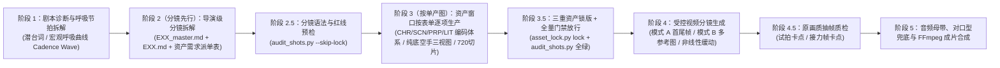

# AI 短剧工业化全流程与各环节提示词设定总规范（`PIPELINE_SPEC` v3.5 · Seedance 2.5 深度工程强化版）

> **核心理念**：剧本与叙事驱动资产（Script-Driven Assets）。用专业电影导演的视听语言与底层扩散机理（Diffusion First-Principles）驾驭生成式 AI 模型，通过严密工程约束系统性消除“AI 塑料感、冰冻木偶、文字字面染色、等长死板节拍、动作融化、失重漂浮与跨集漂移”。
>
> **适配版本**：全面适配 **Seedance 2.5（通用画布/网页即粘即用版）**，兼顾 `dreamina-canvas` CLI 与 `jimeng-novel` 本地工程工具链。
>
> **校准提示（Calibration Notice）**：文中标有 **[CALIBRATE]** 的数值为初始基线。正式锁定本规范前，必须在试拍阶段并对照 Seedance 2.5 官方文档（参考图上限、Prompt 长度、单镜时长范围）完成实测校准。

---

## 一、 端到端 5 阶段标准生产工作流（分镜先行 · 按单产图模式）



> **阶段编号对照**
> - **阶段 2.5** 只做分镜语法预检（`audit_shots.py --skip-lock`）。它不是锁版。
> - **阶段 3.5** 才是资产 SHA-256 锁版，加上不带 `--skip-lock` 的全量预检。
> - 接力帧锁版在 **阶段 4.5 / §8.2**。
> - **§7** 是分镜交付前的呼吸节奏审计，跟阶段 3.5 不是同一件事。

### 1.1 强制执行铁律

1. **分镜先行、按单产图、锁版后开拍**：每集必须 **先由【窗口③ 分镜】解析剧本拆出完整分镜与《本集资产需求派单表》（`shots/EXX_assets_todo.md`）并过 `--skip-lock` 语法预检 → 再移交【窗口② 资产】按单精准补齐缺失资产（0 盲猜、0 浪费）并完成三重 SHA-256 锁版 → 最后全量预检绿灯放行进入阶段 4 试拍与视频生成**。严禁在无锁版资产时盲抽纯文生视频（T2V）。
2. **CLI 原样透传特性与代码块即粘**：`jimeng-novel --prompt-file <md>#<小节>` 会将该 `##` 小节的正文**原样提交**给云端模型，不自动拼接任何前后缀。在 Seedance 2.5 通用画布/网页中，分镜正文封装在纯净 ```text ... ``` 代码块内，可一键全选直粘。正文内**仅保留纯执行提示词**：0 注释、0 未解析占位符、0 占位符残留。
3. **非破坏性资产版本管理**：CLI `--out` 自动将旧产物移入 `old/`；任何本地覆盖已交付文档的流程同样必须先归档旧版。归档文件统一自动命名为 `<原文件名>_v<版本号>_<ISO日期时间>.<扩展名>`（如 `S07_v2_20261118T1430.mp4`），版本号由归档工具单调递增分配，严禁手工篡改。
4. **费用安全与幂等**：任何扣积分操作前必须先运行 `credit estimate`；超时或任务状态不明时只查 `node result`，绝不对状态不明的任务重复提交 `node run`。重试规则详见第 10 节。
5. **典范资产锁版（阶段 3.5）**：资产按派单补齐并验收后，运行 `asset_lock.py lock --scope all`，写入 `cast/LOCKED.json`、`cast/frames/LOCKED_FRAMES.json`、`cast/blocking/LOCKED_BLOCKING.json` 与 `cast/canon/CANON.json`。全量预检会校验这些哈希，不匹配立即阻断。修改任何已锁版资产必须走三步变更流：**变更申请 → 影响波及面评估（查分镜总控表 `Deps` 列，§2.3）→ 重新锁版**。视频接力帧另走 §8.2。
6. **逐镜声明对白音频模式**：每个镜头必须在分镜总控表（§2.3）中显式声明 `Audio Mode`：`native` 或 `vo_lipsync`（定义见 §2.4）。同一镜只选一种。
7. **资产生产统一入口（通用画布 CLI + 0 积分畅用闭环）**：所有图片类资产（角色三视图、表情/状态变体、场景主图、720° 全景、核心道具、Mode A 首帧定姿图）**统一使用通用画布 CLI（`dreamina-canvas`，项目绑定见 `README.md`），不走短剧画布**。默认执行零积分省钱闭环：**① CLI 免费建/改图片节点写入规范提示词（不加 `--run`，0 积分）→ ② 用户在通用画布网页勾选 `0积分畅用` 点击生成（0 积分）→ ③ CLI 用 `node show` + `resource download` 自动拉回本地 `cast/` 或 `cast/frames/` 并执行 `asset_lock.py lock --scope all` 锁版**。仅在用户明确授权扣积分直出时，方可带 `--run` 报价提交。

---

## 1.2 Seedance 2.5 底层扩散机理与五大根因诊断（Root-Cause Diagnosis）

针对视频生成模型常见的 5 大核心翻车问题，本规范从扩散模型（Video Diffusion）底层数学机理推导其生成根因，并制定对应的治本工程对策：

### 1. 冰冻木偶与死亡世界（Frozen Puppets & Dead World）
- **底层机理**：视频扩散模型在时间去噪过程中，优先收敛于时间上最连贯、变化最小的极值解——“静止”是算力代价最低的时序一致性解。提示词中只有带有显式动态动词（Motion Verbs）的 Token 才能获得交叉注意力权重（Cross-Attention Weight），未被提及的实体默认继承“保持不动”的先验。说话角色的词汇密度最高（嘴巴、表情），注意力完全集中在其脸上；而听者和背景无动词描述，直接被冻结为蜡像。
- **治本对策（三层动态环境预算 + 听者物理待机库）**：
  - **三层动态环境（Three-Layer Ambient Motion Budget）**：
    - **前景待机层（Foreground Idle）**：不处于主发力状态的角色必须分配显式待机微动作（呼吸起伏、指尖轻叩、重心换脚、缓慢眨眼）；
    - **中景物理层（Midground）**：次要人物、道具、布料甩动、茶杯蒸汽、飞溅火星；
    - **背景介质层（Background）**：天气流动（雨滴划窗、暴风摇树）、光影突变（霓虹微烁、闪电划过）、空气悬浮微粒（丁达尔尘埃）。
  - **连续动态 vs 突变节拍**：每层至少包含一个“连续运动”（如雨滴流动、蒸汽上升）和一个“偶然突变”（如水滴落下、阴影掠过），打破死板循环。
  - **严禁写“在听 / 站着不动”**：听者绝不是静止的，必须赋予具体生理与小动作（见 §5.1）。

### 2. 字面染色与文本广播谬误（Literal Dyeing）
- **底层机理**：文本编码器（如 CLIP / T5）会将颜色与状态修饰词直接绑定到最近的名词，并广播到该实体的整个视觉生成区域。写“脸红”会被直接渲染为“整张脸涂满红油漆”；写“眼前发黑”会导致全画幅全局亮度归零（黑屏）；写“咬牙切齿/冷汗”会召回训练集里的极端夸张动漫/恐怖片夸张纹理。
- **治本对策（生理机理翻译层 The Physiological Translation Layer）**：
  - **严禁写成语与修辞**：将一切情绪翻译为**三元组物理通道**：
    1. **具体生理机理（Mechanism）**：肌肉收缩、瞳孔变化、呼吸频次、视线焦点、下颌变化；
    2. **局部区域与微度（Locality & Degree）**：“颧骨与耳尖隐约泛起极微弱红晕”；
    3. **保真条款（Preservation Clause）**：“面部其余区域保持自然健康肤色，无全局调色漂移”。
  - **正面描述优先（Positive-Only Phrasing）**：写“面部保持自然肤色”，避免写“不要绿脸/不要红脸”（否定词仍会把颜色 Token 注入上下文引发负向召回）。

### 3. 蜂群同质化（Synchronized Hive-Mind）
- **底层机理**：集合名词（如“众人低头”、“大家吓了一跳”）作为单一条件信号广播给画面中的所有人物实例，导致所有人以完全相同的动作、振幅与速度同步起落，呈现极其假劣的人形机器人视效。
- **治本对策（站位槽位切分与错峰启动 Individuation & Stagger）**：
  - 严禁使用任何集合动词；
  - 按画面空间槽位对前景关键人物（≤3人）逐一命名分工（如“左侧近景角色A”、“右侧中景角色B”）；
  - 为每个角色设定不同的**启动延迟时间差（Onset Offset，如 +0.0s、+0.8s、+1.6s）**、不同的**动作振幅**与**动作速度**；
  - 必须至少保留 1 名角色反应迟钝、慢半拍甚至毫无反应，体现现实人群的非对称性。

### 4. 肢体融化、缺乏惯性与对讲机式对白
- **底层机理**：单镜头内塞入过多关节自由度（Multi-Limb Choreography）会导致扩散潜在空间发生塌陷与融化；动作只描述发力峰值（Peak）会导致动作没有预兆突发启动、随后僵硬截断；严格轮流说话导致画面像对讲机通话。
- **治本对策**：
  - **统一动作预算（Action Budget）**：每 5 秒仅允许 1 个主要动作 + 1 个次要动作 + 环境微动；
  - **三拍子动词（Three-Beat Verbs）**：每个核心动作必须拆分为**蓄力起势 (Anticipation) ➔ 动作冲量 (Action) ➔ 锁死终态与惯性衰减 (Settle & Follow-Through)**，必须明确交代动作结束时的停滞姿态；
  - **对白打破对讲机**：听者在对方说话前 0.5s 先产生生理反应（眉峰微动、手指扣紧），允许台词打断与自然留白。

### 5. 漂浮幻灯片综合征与匀速失重感（Floating Slideshow Syndrome）
- **底层机理**：视频扩散模型默认采用均匀线性数学插值计算帧间潜变量。若不提供明确的动力学冲击量与物理阻尼描述，模型将默认以恒定线速度匀速运动，导致角色漂浮、失重、像在水中滑行；且若全片每镜时长均等（如死板的每镜 5 秒），将形成节拍器般的机械感，彻底扼杀视听呼吸。
- **治本对策（呼吸式动力学架构 The Respiratory Kinetic Architecture）**：
  - **宏观呼吸节拍波（Macro Cadence Wave）**：镜头时长坚决反对均等化，依照戏剧张力划分为三段式节拍呼吸波：
    - **蓄势/悬念吸气拍（Inhale）**：`4.0–6.0 秒`，静态机位或极缓慢推进，捕捉微细生理与尘埃漂浮，维持令人窒息的静态凝固感；
    - **点火/冲突呼气拍（Exhale）**：`1.5–3.0 秒`，短促、极速爆发、集中动能冲击量、0 浪费帧；
    - **余韵/沉降屏息拍（Hold）**：`4.0–5.0 秒`，动作落地锁死、尘埃微粒沉降、呼吸喘息、声学真空余韵。
  - **微观非线性缓动（Micro Kinetics & Easing）**：
    - 严禁匀速线性位移；所有大动作必须遵循：**蓄力（0.5–0.8s 质心下沉或短暂停顿）➔ 爆发（突加加速度与动量释放）➔ 撞击锁死与惯性衰减（动作骤停锁死，衣摆、发梢、灰尘向前冲出并阻尼落定）**；
  - **动态反差不对称（Dynamic Contrast）**：主体静止时拉满环境动态（风卷落叶、火苗狂跳）；主体剧烈运动时，画面机位严禁复杂晃动，锁定绝对基座以放大相对速度与撞击冲击力。

---

## 二、 阶段 1：剧本解析与宏观呼吸节拍拆解

### 2.1 导演解析表
解析 `scripts/第XX集_*.md` 时，必须逐场输出导演解析表，回答 4 个核心视听问题：

| 维度 | 必须明确的内容 | 反面教材（禁止） |
| :--- | :--- | :--- |
| **1. 叙事动机** | 这一场/这一镜为了推进什么核心信息、悬念或剧情反转？ | 机械演完每一句台词的流水账 |
| **2. 呼吸节拍类型** | 本镜属于 Cadence Wave 哪一拍？（吸气蓄势 Inhale 4-6s / 呼气爆发 Exhale 1.5-3s / 余韵沉降 Hold 4-5s） | 毫无起伏的千篇一律 5 秒剪辑 |
| **3. 视听支点** | 景别、视点高低、前景物理遮挡、冷暖光对比与空气介质。 | 单一平视居中正脸中景 |
| **4. 资产复杂度评估** | 评估潜在 AI 高危点（多人纵深、高速物理接触、猛兽咬合、核心信物），确定所需资产种类。 | 全集死磕一张通用底图 |

### 2.2 对白长度硬上限
- **中文**：正面近景开口，写作目标 **≤ 8 字**，预检硬上限 **10 字**（超过 10 字直接拦截）。大约 2.5–3.0 秒说完。
- **英文及其他语种**：单句 **≤ 10 个音节**。单镜对白最多 2 句短句。
- **余韵拍时长**：Hold 的硬区间与吸气拍相同，是 **4.0–6.0 秒**。4.0–5.0 秒是余韵的优选，5.1–6.0 秒预检放行。
- 超长对白必须通过切镜、画外音（VO）、听者微反应切入或过肩背影（OTS）消化。

### 2.3 分镜总控表架构（`shots/EXX_master.md` · 13 列标准）
每集独立维护一张**非提交**的分镜总控表 `shots/EXX_master.md`：

| 列名 | 内容说明 |
| :--- | :--- |
| `Shot` | 镜号，如 `S07` |
| `Dur` | 单镜时长（秒） **[CALIBRATE: 1.5–6.0 s]**（服从呼吸节拍波，禁止全集均长） |
| `Scene` | 场景资产编号或别名（如 `@维修铺`） |
| `Characters` | 本镜出镜/在场角色状态码（🎬 出镜 / 👂 画外存在 / ❌ 合理不在场，禁 ⚠️） |
| `Mode` | `A`（首尾帧 I2V）或 `B`（多参考图） |
| `Refs` | 挂载清单：Mode B 写 `@别名=cast/...`；Mode A 写 `首帧=cast/frames/...` |
| `Frame Status` | 首尾帧需求级别：`Mandatory`（必须） / `Recommended`（推荐） / `Not Required`（不需） |
| `Audio Mode` | `native`（原生人声）或 `vo_lipsync`（外部配音 + 对口型） |
| `Emotion In → Out` | 入镜情绪 → 出镜情绪标签 |
| `Bridge` | `None` 或 `Requires Post Audio Bridge`（§7 情绪跳跃声学过渡桥） |
| `Cadence Beat` | 呼吸节拍分类：`Inhale (4-6s)` / `Exhale (1.5-3s)` / `Hold (4-5s)` |
| `Deps` | 本镜依赖的全部资产路径清单，用于资产变更波及面审计 |
| `QC` & `Attempts` | 质检状态与生成尝试次数记录（§10） |

单元格内部用全角 `｜`。半角 `|` 会被表格拆成新列，预检会把 Cadence 和 Deps 读错位。

### 2.4 对白音频模式（Audio Mode）

| 值 | 什么时候用 | 正文怎么写 |
| :--- | :--- | :--- |
| `native` | 正面开口，口型和人声交给 Seedance 2.5 一起生成 | 写「台词」，音轨白名单保留「角色人声」 |
| `vo_lipsync` | 要外配、方言，或口型必须事后对齐 | 总控表标 `vo_lipsync`。视频正文仍遵守 10 字硬上限；外配音在阶段 5 贴上，并按 §7 做声学过渡 |

同一镜只选一个。正面特写要模型自己发声，用 `native`。成片必须锁一条外部音轨，用 `vo_lipsync`。

---

## 三、 阶段 2：资产分类与标准编号体系（Asset Taxonomy）

### 3.1 核心原则：参考图承载身份，提示词承载行为与增量
**References own identity. Text owns behavior and deltas.**
- 如果角色的面容、基础发型、贴身服装或房间结构已经在参考图中锁定，**提示词中严禁重复描写这些固有容貌特征**（重抄只会让扩散模型重新采样导致变脸）。
- 提示词仅描述：**空间站位、行为动作、非线性动力学、生理微反应与状态增量（如雨湿、泥污、撕裂）**。
- 参考图越纯净（空手自然下垂、中性表情、无多余外挂道具），视频扩散模型演绎动作与情绪的自由度越大。

### 3.2 标准资产分类与编号（Asset ID Architecture）

| 资产编号代码 | 资产类型说明 | 核心用途与约束 | 目录与文件范例 |
| :--- | :--- | :--- | :--- |
| **`CHR-<name>-TURN`** | 角色纯人物空手基础三视图 | 锁定面部骨相、五官、体格、基础服装；**严守空手无道具铁律**，双手自然垂于体侧，平视摄影棚纯底 | `cast/<角色>.默认.png` |
| **`CHR-<name>-EXP`** | 角色表情与微反应锚点卡 | 锁定极端或关键情绪结构（专注、戒备、强忍泪水），保持自然肤色，无字面染色 | `cast/<角色>.<表情>.png` |
| **`CHR-<name>-STATE`** | 角色特殊状态/换装/战损卡 | 剧情触发的泥泞、雨湿、撕裂、伤痕装，**必须由基础三视图直接派生** | `cast/<角色>.<战损态>.png` |
| **`SCN-<place>-MASTER`** | 场景主控空镜图 | 确定物理空间布局、地貌、主要陈设与唯一主光源事实；**严禁出现人物** | `cast/<场景>.默认.png` |
| **`SCN-<place>-GRID`** | 场景多机位四宫格展板 | 720 全景切片拼接的 16:9 四联纯净展板（反打/俯视/左侧/右侧，**严禁含任何文字说明**） | `cast/<场景>.多机位展板.png` |
| **`SCN-<place>-ANGLE-x`** | 场景反打与特定机位图 | 保持空间布光一致的反向视点或关键作业区（通过四宫格切片或 720 切片提取） | `cast/<场景>.机位_<名>.png` |
| **`SCN-<place>-MAP`** | 俯视空间走位地图 | 标记门、窗、主要家具与角色左右站位，锁定 180° 轴线（仅供人看规划） | `cast/storyboard/<场景>.map.png` |
| **`PRP-<item>`** | 核心信物与道具特写卡 | 1:1 或 16:9 中性灰底孤立特写，两角度展示，确定材质质感与磨损纹理 | `cast/<道具>.默认.png` |
| **`LIT-<scene>`** | 空间环境光影基调参考 | 确定主光源色温、反差比与空气介质调性 | `cast/<场景>.光影基调.png` |
| **`BLK-<EXX>-<SXX>`** | 单镜彩色白模人偶站位图 | 确定单镜 3D 机位、构图、景深与彩色人偶站位（§3.3） | `cast/blocking/EXX_SXX_blocking.png` |
| **`FRM-<EXX>-<SXX>`** | 动态首尾定姿帧与接力帧 | 模式 A 专用，关键物理瞬间定姿图或上镜过审视频 100% 原画质末帧 | `cast/frames/EXX_SXX_first.png` |

**规则 P-1（挂载作用域隔离）**：仅 `cast/`、`cast/frames/` 与 `cast/blocking/` 允许挂给视频模型；`cast/storyboard/` 仅供导演审阅，严禁挂载。
**规则 P-3（一角一源）**：单镜内每个角色最多绑定 1 个图源（启用派生变体卡时直接替换基础卡，严禁并存）。

### 3.3 彩色白模人偶站位图系统（Color-Coded Mannequin Spatial Blocking System · `BLK-<EXX>-<SXX>`）

1. **核心设计机理（极简 3D 灰模空间与三权解耦）**：
   在多人同框、复杂机位或深度对峙分镜中，单纯依赖文本修辞（如“角色A在左侧，角色B在右侧”）极易引发扩散模型空间混乱（左右站位颠倒、体态透视失调、视线错位或肢体穿模粘连）。
   **严禁在站位图中使用复杂写实/实拍场景背景**！若站位图包含写实背景，会与专属场景母卡（`@场景`）产生强烈的“多参考图特征打架（Cross-Attention Collisions）”，诱发背景抖动、道具漂移与空间形变。
   因此，站位图采用影视工业级**极简 3D 灰模预演空间（Minimalist 3D Whitebox Stage）**：
   - 纯净中性浅灰三维摄影棚空间，地面带有微弱写实的透视参考网格线（Perspective Floor Grid）；
   - 空间中仅用极简无贴图的浅灰白模几何体块（Bounding Boxes，如长方体代表工作台、矩形框代表门窗）示意障碍物，**绝无任何真实墙面纹理、实物贴图或繁杂陈设**；
   - 空间中精准放置具备严谨骨骼体态与高矮比例的**纯色彩色白模人偶（Solid Matte Color Mannequins）**，人偶**无五官、无毛发、无真实服装细节**，避免与真实人脸对抗争抢；
   - 每个人偶采用**全剧固化的独立纯色**，在视频提示词中显式绑定：`@站位图 中的橙色人偶对应 @主角A，蓝色人偶对应 @配角B`。

2. **全剧角色固定白模色彩代码表（Color Codebook 示例）**：
   | 角色名 | 固化白模颜色 | 对应核心视觉特征 |
   | :--- | :--- | :--- |
   | **主角A** | **纯亮橙色人偶（Solid Vibrant Orange Mannequin）** | 青年精干男主、核心特征服饰 |
   | **主角B / 配角A** | **纯深蓝色人偶（Solid Navy Blue Mannequin）** | 魁梧体格、工装或重装体态 |
   | **主角C / 女主** | **纯翠绿色人偶（Solid Emerald Green Mannequin）** | 敏捷苗条体型、轻装姿态 |
   | **长辈 / 反派** | **纯深赭石色人偶（Solid Dark Ochre Mannequin）** | 沧桑威严体型、特色服饰或配件 |
   | **次要配角/路人** | **纯浅灰色人偶（Solid Light Gray Mannequin）** | 次要体态、背景站位 |

3. **三权分立解耦架构与防漏条款（Three Pillars of Authority）**：
   - **`@场景`（场景母卡）** ➔ **100% 独占权威**：唯一掌控真实空间结构、墙面纹理、陈设细节、主光源布光与天气介质；
   - **`@站位图`（极简白模站位图）** ➔ **100% 独占权威**：唯一掌控机位透视、景深层级、人物空间三维坐标、高矮体态与视线轴线（正文注明忽略灰模网格）；
   - **`@角色`（角色三视图）** ➔ **100% 独占权威**：唯一掌控真实人类五官、皮肤毛孔肌理与写实服装纤维。
   - **双向防漏约束（正文只写正向句）**：`全场环境完全以 @场景 的写实材质与布光渲染，所有出镜角色呈现真实人类皮肤、毛孔与织物。站位图只提供坐标、透视与骨骼姿态。` 映射句里可以写「橙色人偶对应 @角色A」。收尾句不要再写「不要白模 / 严禁塑料」，那些词会被扩散模型召回成塑料人偶。

4. **参考图槽位优化策略（Save-a-Slot Strategy）**：
   在 Seedance 2.5 单镜上限 **[CALIBRATE: 4]** 张框架下，双人核心对峙戏形成完美 4 图闭环：
   `@场景` (1 张) + `@站位图` (1 张) + `@角色A` (1 张) + `@角色B` (1 张) = **刚好 4 张**！三图源权威解耦，彻底终结背景漂移与站位混乱。

5. **生产与锁版闭环**：
   由【窗口③ 分镜】在 `shots/EXX_assets_todo.md` 列出 `BLK-<EXX>-<SXX>` 需求与提示词（按 `templates/05_彩色白模站位图_模板.md` 生成），【窗口② 资产】在通用画布通过 `0 积分畅用` 生成并存入 `cast/blocking/EXX_SXX_blocking.png`，随后执行 `python 02_规范与工具/tools/asset_lock.py lock --scope blocking` 锁定 SHA-256。

### 3.4 场景多机位工业规程：720° VR 全景虚拟切片体系（废除 2D 文本生成四宫格）

1. **底层机理与根因诊断（为什么 2D 提示词生成“四宫格场景图”必然对不上？）**：
   2D 图像扩散模型缺乏内部三维 CAD/几何物理引擎。当在提示词中要求 AI 在同一张图内画出“反打视角、左右视点、俯瞰视角”四个分格时，模型是在潜在空间中并发绘制 **4 个彼此独立的平行宇宙场景**：
   - 反打格子里的大门结构与位置，必然与主视图里的后墙空间冲突；
   - 俯视格子里的桌椅摆放几何关系，必然与侧视机位完全错位；
   - 四个格子的光影高光与陈设道具各说各话，导致下游分镜在切机位时严重空间穿帮与变脸。
   **【红线铁律】严禁使用纯文字提示词让 AI 盲抽“场景四宫格”！**

2. **唯一权威工业解法：【主视图 ➔ 通用画布 720° 全景图 ➔ 本地 `pano_to_grid.py` / `extract_pano.py` 提取机位】**：
   - 在通用画布基于场景主视图（`SCN-*-MASTER`）使用【超分 ➔ 原生 720° 全景】一键生成 **等距柱状球形全景图（`SCN-*-PANO` · `cast/<场景>.全景720.png`）**；
   - 720° 全景图是一个**真实、闭合、360°×180° 的球形三维物理事实**，房间的前后左右、天花板与地面全部缝合在同一几何空间内；
   - 运行本地全自动投影切片工具（`python 02_规范与工具/tools/pano_to_grid.py --input cast/<场景>.全景720.png`），2 秒内全自动提取 4 大机位并拼合为纯净四宫格展板：
     - **纯净四宫格展板（`cast/<场景>.多机位展板.png`）**：**【铁律】展板内严禁包含任何文字标牌、角标、说明或水印**，保持画面 100% 纯净环境，防止下游模型特征污染；
     - **反打机位 (Reverse Angle · 看大门与入口)**：`--yaw 180 --pitch 0` ➔ `cast/<场景>.机位_反打.png`；
     - **俯视机位 (Top-Down / High-Angle · 鸟瞰全场)**：`--yaw 0 --pitch -50 --fov 90` ➔ `cast/<场景>.机位_俯视.png`；
     - **左侧机位 (Left Side Angle · 看左墙与大窗)**：`--yaw -90 --pitch 0` ➔ `cast/<场景>.机位_左侧.png`；
     - **右侧机位 (Right Side Angle · 看右侧货架)**：`--yaw 90 --pitch 0` ➔ `cast/<场景>.机位_右侧.png`；
   - 提取完毕后运行 `python 02_规范与工具/tools/asset_lock.py lock --scope cast` 锁定切片。分镜编写需要反打镜头时，直接挂载切出的 `cast/<场景>.机位_反打.png` 即可实现 100% 严丝合缝的空间连贯！

---

## 四、 标准提示词设定（Prompt Anatomy · 8 大补偿层架构）

面向 Seedance 2.5 视频模型，每个镜头提示词必须依照严密的 **8 大补偿层结构（The Compensatory Layers）** 组装：

1. **参考映射（REFERENCES）**：绑定资产 ID 与严格的角色边界（仅身份与服装 / 仅空间与布光 / 仅道具），杜绝模型抄袭参考图姿态。
2. **机位与运镜（SHOT）**：景别、视点高低、镜头质感、**单一镜头运动（One Movement Only）**、时长。
3. **空间站位（BLOCKING）**：各实体空间坐标、绝对朝向、具体视线锚点焦点、各主体物理间距与景深分层。
4. **时序与非线性动效（TIMELINE）**：分秒节拍，每个大动作必须呈现「蓄力 (Anticipation) ➔ 爆发 (Action) ➔ 撞击锁死与惯性衰减 (Impact Lock & Follow-Through)」，必须交代稳定终态。
5. **三层动态环境预算（AMBIENT MOTION BUDGET）**：
   - **前景待机（Foreground Idle）**：听者或未发力角色的具体待机生理与微动作；
   - **中景微动（Midground）**：次要人物、道具扰动、蒸汽、布料甩动；
   - **背景介质（Background）**：天气雨滴、闪电、摇曳树影、光柱悬浮微尘。
6. **对白与听者先发反应（DIALOGUE）**：说话人、≤8–10字台词、发音开始时间点；听者在开口前的先发微动作反应。
7. **光影与生理保真（LIGHT & COLOR）**：真实光源方向 + **面部情绪肤色保真条款（自然肤色保持不变，无调色漂移）**。
8. **镜头衔接与约束（HANDOFF & CONSTRAINTS）**：承接上一镜终态，交代下一镜起点状态；纯物理声源音效 `<SFX>`；无台词镜硬锁「全程不说话」且禁写「角色人声」。每镜正文末尾逐字写「不要生成旁白字幕、台词字幕或对白字幕。」引号里的字只给嘴型和声音，不画进画面。成片字幕若需要，在阶段 5 用 `EXX.srt` 外挂。

---

## 五、 消除“AI 感”的 15 条导演级硬性规范（含两大核心词典）

### 5.0 摄影机禁用词替换表
所有提交正文**严禁出现 `camera`、`lens`、`镜头` 三词**（预检拦截）。一律改写为：
- `镜头推进` ➔ `画面平滑推进 / 视点缓慢前移`
- `固定镜头` ➔ `固定机位 / 静止画面`
- `绝不看镜头` ➔ `视线死锁窗框外的远山 / 眼神紧盯扳手齿口`

---

### 5.1 生理机理翻译标准词典（规避字面染色与抽象情绪词 · 规则 3 升级）

严禁在提示词中直接使用成语、抽象形容词或颜色状态词描述人体（如“暴怒”、“极度震惊”、“脸红”、“脸色发白”、“眼前发黑”）。必须按以下三元组词典进行物理降维转换：

| 剧本成语/情绪 | 严禁写法（字面染色翻车） | 标准物理降维翻译写法（机理 + 局部微度 + 肤色保真条款） |
| :--- | :--- | :--- |
| **害羞 / 脸红** | 脸红了、脸颊涨红 | 颧骨高处与耳尖微泛极淡微温红晕，缓慢浮现。面部其余区域保持自然健康肤色不变，无全局调色漂移。视线微向下垂，下颌微收。 |
| **恐惧 / 脸色煞白** | 吓得脸色惨白、面无血色 | 面部神态骤然凝固，眨眼停滞，嘴唇紧抿泛平，鼻翼微张屏息片刻后微弱浅呼吸。面部保持自然肤色与均匀光影，无曝光突变。 |
| **眩晕 / 眼前发黑** | 眼前一黑、头晕目眩 | 双眼极缓慢长眨一次，背景焦点微向后虚化失焦，单手急促撑住最近的坚固物体表面，身体质心轻微晃动后稳住。画面整体曝光保持不变。 |
| **咬牙切齿 / 恨极** | 咬牙切齿、面目狰狞 | 咬肌在下颌转折处骤然绷紧隆起，双唇始终自然紧闭，鼻翼微张微颤。口腔与面部轮廓保持自然生理结构。 |
| **冷汗直冒** | 额头满是冷汗、大汗淋漓 | 太阳穴处隐约凝结一颗微小汗珠并在光下泛出微弱高光，喉结微弱上下滚动一次。面部皮肤肌理与质感保持自然洁净。 |
| **心沉谷底 / 绝望** | 心沉了下去、心碎绝望 | 双肩极细微向下沉落两厘米，鼻腔极缓慢呼出一口长气，双眼视线无焦点下落。神情静止凝滞。 |
| **暴怒 / 怒火中烧** | 暴怒、怒目圆睁、浑身发抖 | 仅右手五指产生极其细微的克制紧绷颤抖，握持物体的指节轻微发白，声音低沉平缓，双肩锁死不动。 |
| **群体羞愧 / 尴尬** | 众人都感到很羞愧 | 依站位分配给 2–3 名具名角色不同微动作：左侧角色视线偏转向下，右侧角色抬手微扯衣角，错峰间隔 0.8 秒启动；至少 1 人毫无动作。 |
| **热泪盈眶** | 泪流满面、号啕大哭 | 下眼睑边缘泛起微弱湿润水光，缓慢眨眼一次，仅有一滴悬而未决的泪水凝在睫毛末梢、未曾滚落。眼神保持稳定清亮。 |

---

### 5.2 非线性动力学与缓动词汇表（规避失重漂浮与匀速滑动 · 规则 5/8 升级）

严禁使用恒定匀速动词（如“走过去拿起”、“转过头看着”）。所有大动作必须依照「蓄力起势 (Anticipation) ➔ 爆发冲量 (Burst) ➔ 撞击锁死与惯性过冲衰减 (Impact Lock & Follow-Through)」标准句式撰写：

| 动力学动作意图 | 严禁写法（匀速漂浮慢动作） | 标准非线性缓动与惯性过冲翻译写法 |
| :--- | :--- | :--- |
| **骤然伸手 / 抓取** | 伸手抓起桌上的票据 | 指尖在裤袋边缘悬停顿挫 0.5 秒（蓄力），随即右手以骤加加速度向前疾探，五指精准扣紧硬质票据表面并骤然锁死静止；冲锋衣袖口因惯性向前滑窜后自然回落服帖。 |
| **猛烈回头 / 警觉转头** | 转过头看向她 | 视线在前方死锁半拍（蓄力），随后头部以极高角速度猛烈甩向画面右侧画外目标方位；耳际发梢因惯性轻微向外过冲甩动，随后迅速回弹并阻尼落定锁死，眼神凝固。 |
| **霍然起身 / 拍案起立** | 从椅子上站起来 | 双手手掌平平撑在木桌边缘，上身微向前倾压低质心（蓄力），随后双臂与腰腹骤然爆发向上挺起，身躯霍然拔直站立；衣摆与腰带因惯性向前剧烈甩动，晃荡两次后渐止服帖。 |
| **重击 / 拍桌 / 怒砸** | 挥拳砸在桌子上 | 前臂向上抬起并在空中短暂悬停半拍（蓄力），紧接着右拳以极高速度垂直下砸；指节重重砸击在厚木台面并瞬间冲击锁死不动；周围台面细微浮尘震荡扬起，小工具产生微弱跳跃碰撞声。 |
| **骤然僵死 / 突发震惊** | 听到声音停下动作，很震惊 | 正在作业的右手在半空中瞬间绝对刹车锁死；吸气骤然卡在喉头，双肩肌肉完全绷紧僵固；腰间悬挂的细小金属挂件因惯性继续产生轻微残留晃动，逐渐衰减至静止。 |

---

### 5.3 15 条导演级硬性规范完整清单

- **规则 1（绝对视线锚点）**：每名角色必须写明绝对朝向与**具体画内实物或偏角方位**。**严禁写“看着对方”，严禁写“正视前方 / 直视前方 / 面向正前方 / 看向观众”**。
- **规则 2（打破对讲机对话）**：听者在发言前必须有先发微反应；善用环境声响阻断对话；禁止轮流均长对白。
- **规则 3（生理机理翻译）**：执行 §5.1，全面消除抽象强情绪词与字面染色。
- **规则 4（手部实物绑定）**：手部必须与具体工具、布料或身体部位产生接触锚定，消灭无意义悬空抖动。
- **规则 5（统一动作预算与非线性动力学）**：单拍 2–4 秒仅容纳 1 个主动作；打斗/翻滚硬上限 ≤2 秒；爆发动作必须执行 §5.2 写明蓄力与惯性收力终态。
- **规则 6（默认正向描述，严禁滥贴排除词）**：仅描述画面中所见；**默认不写 `Exclusions:`**，严禁批量复制未经试拍验证的 `文字, 水印, 边框`。
- **规则 7（双模式实体规范）**：
  - **模式 B（多参考图）**：正文统一使用 **`@别名`**（如 `@场景`、`@角色A`），上限 **[CALIBRATE: 4]** 张；
  - **模式 A（首尾帧 I2V）**：仅挂首帧（`cast/frames/...`），正文用纯角色名、**严禁出现任何 `@别名` 或 `{{别名}}`**。
- **规则 8（宏观呼吸节拍波 Cadence Wave）**：全场镜头按呼吸曲线波浪起伏：`1.5–3.0s` 爆发 vs `4.0–6.0s` 蓄势与余韵，严禁均长剪辑。
- **规则 9（三层景深与分层走位）**：多实体同框必须明确划分景深层（近/中/远）与物理间隔距离（如“相隔两米泥地”）。
- **规则 10（单一主光源与空气介质）**：继承场景底图主光，写入具体空气介质（雨丝、浮尘、冷气白雾）。
- **规则 11（自然微瑕疵纹理）**：强调布料折痕、泥浆飞溅、金属磨损，杜绝 `masterpiece, 8k` 空洞词汇。
- **规则 12（规避高穿模姿态与柔性物件惯性）**：回避交叉双臂与十指相扣；发辫、衣摆必须注明惯性甩动方向（规则 12b）。
- **规则 13（服装关键材质锚点）**：每镜正向强化 1–2 处关键材质（金属拉链反光、铜扣、皮质纹理），作为抽帧质检核心点。
- **规则 14（全物理声源，严禁 BGM）**：所有音效必须用 `<物理声源音效>` 标注且可物理溯源；Prompt 内严禁出现 `BGM/背景音乐/配乐/music/score`。
- **规则 15（全员在场闭环）**：总控表中每镜必须完整标注所有角色的在场状态（🎬/👂/❌），0 漏标、0 出现 ⚠️。

---

## 六、 Seedance 2.5 生视频提示词标准格式（通用画布/网页即粘即用版）

每集 `shots/EXX.md` 面向【窗口④】直接在 **Seedance 2.5 通用画布 / 网页端视频生成节点** 全选代码块复制粘贴。每镜由「2 行元数据卡头」+「1 个纯净 `text` 代码块」组成：

### 6.1 模式 B 模板（多参考图模式 · 挂载 `@别名` · 呼吸节拍与三层动态完整范式）

````markdown
## S01
- **参数**：`Seedance 2.5` ｜ `Mode B（多参考图）` ｜ `16:9` ｜ `4.0s` ｜ `Audio: native` ｜ `Cadence: Inhale`
- **挂载参考图（≤4张）**：`@工坊`=`cast/工坊.机位_工作台与雷雨窗.png` ｜ `@角色A`=`cast/角色A.默认.png`

```text
国漫3D（CG）写实高精度风格，电影级光影质感，顶级3D动漫电影渲染级别，真实物理材质与自然微瑕疵纹理，强明暗情绪反差，浅景深与空气介质微尘感。

参考映射：@工坊 为场景空间与布光基准（仅环境）；@角色A 为角色面部与服饰基准（仅外貌，非姿态）。
本片段设定在 @工坊。桌面散落机械零件与冷光油污，窗外暴雨如注。整体基调：暖黄工作台吊灯与冷蓝窗外雷雨形成强烈冷暖对冲，中景微弱景深虚化。

拍子1（0.0–2.0秒）：中景单人视点，机位固定静止。@角色A 位于画面左侧台前，侧身面朝右侧工作台，视线死死聚焦在桌面的微型游丝齿轮上；双手手掌平平撑在木桌边缘，上身微向前倾压低质心（蓄力），指节因用力而微弱泛白；深色工装边缘带着真实机油折痕。角色胸膛微弱起伏呼吸，全程保持专注待机。窗外暴雨沿窗玻璃不规则流淌，吊灯光柱中悬浮细微尘埃。<工作台零件轻微金属碰撞声与窗外沉闷雷雨声>
拍子2（2.0–4.0秒）：画面平滑微距推进。@角色A 猛然直起身躯，双臂向上挺起站立，系带因惯性向前甩动随后回落服帖（终态锁死）；神情凝固，开口低沉说道：「零件全被动过了。」面部颧骨处保持自然微黄肤色，无调色漂移。<木桌受力摩擦声与低沉叹气声>

音轨仅保留角色人声、环境声与物理动作音效；画面中所有出镜角色动作稳定自然。不要生成旁白字幕、台词字幕或对白字幕。
衔接：角色A站立于桌前，右手仍按在台面边缘。
```
````

---

### 6.2 模式 A 模板（首尾帧 I2V 模式 · 纯角色名 · 爆发呼气节拍范式）

````markdown
## S04
- **参数**：`Seedance 2.5` ｜ `Mode A（首尾帧 I2V）` ｜ `16:9` ｜ `2.5s` ｜ `Audio: native` ｜ `Cadence: Exhale (Burst)`
- **挂载首帧（不挂其他参考图）**：`首帧`=`cast/frames/E01_S04_first.png`

```text
国漫3D（CG）写实高精度风格，电影级光影质感，顶级3D动漫电影渲染级别，真实物理材质与自然微瑕疵纹理，强明暗情绪反差，浅景深与空气介质微尘感。

紧接首帧画面直接延续动作。泥泞林地，暴雨如注，空气中弥漫飞溅雨雾与湿冷水汽。
拍子1（0.0–1.2秒）：低机位仰角仰视，机位绝对固定锁死。主角 维持首帧右腿弓步起势，脚下泥浆飞溅；双臂将长矛以极高加速度向前迅猛平刺破空而出，矛杆保持笔直刚性，红羽饰因惯性向后紧绷拉直。<矛尖破风锐啸声与脚下泥泞踩踏飞溅声>
拍子2（1.2–2.5秒）：矛尖猛烈凿入粗糙树干，双臂惯性前送并在伸直位骤然冲击锁死（终态姿态完全定住）；上衣布料在紧绷状态下骤停，衣摆因余震轻微向前颤动两次后落定服帖。树干震落大片雨水与松针。<沉重钝响撞击声与密集落叶水滴声>

画面中所有出镜角色全程不说话。音轨仅保留环境声与物理动作音效。不要生成旁白字幕、台词字幕或对白字幕。
衔接：主角双手紧握矛杆维持刺入锁死姿势，胸膛剧烈喘息。
```
````

---

## 七、 分镜交付前：宏观呼吸节奏与情绪断裂检测

全集分镜拆解完毕后，由【窗口③】进行呼吸节奏与情绪平滑度双重审计：
1. **宏观呼吸波检查（Cadence Wave Audit）**：统计全集时长分布，确保场景张力符合“吸气蓄势（4–6s）➔ 呼气爆发（1.5–3s）➔ 屏息沉降（4–5s）”交替波浪；**严禁全集所有镜头均为均等时长**。
2. **情绪过渡桥（Audio Bridge Gate）**：凡在总控表中标记 `Requires Post Audio Bridge` 的切点，阶段 5 必须施加 **[CALIBRATE: 0.5] 秒** 音轨交叉淡化或微弱环境声衰减垫底，防止听觉与情绪断裂。

---

## 八、 阶段 4.5 & 5：原画质抽帧验收、音频母带与成片合成

### 8.1 试拍卡点（放量前必跑 2 镜代表样本）
每集放量出片前，必须先生成 **2 镜试拍样本**（1 镜室内微表情/生理对话 + 1 镜室外高速爆发动作）。8 项全部通过（ALL PASS）方可放行全集：
1. **身份稳定**：可见面孔特征与锁版三视图相似度稳定，无连续 ≥3 帧失真；
2. **视线纪律**：0 次直视正前方看镜头；
3. **口型同步**：对白起音点与唇形错位 ≤2 帧；
4. **物理穿模**：核心动作区 0 穿模，非核心区连续穿模 <1 次/4秒；
5. **动作收力终态**：末 0.5 秒主体动作收敛至稳定终态，无突发硬截断；
6. **180° 轴线**：空间站位与视线夹角 0 次越轴；
7. **材质锚点**：规则 13 关键材质纹理在可见帧中稳定呈现；
8. **景深分层**：多实体同框呈现清晰纵深间隔，无平面纸片重叠。

抽帧时另看一条：画面里不出现旁白字幕、台词字幕、对白字幕。出现了就改尾注后重拍。成片字幕只走外挂 `srt`。

### 8.2 接力帧标准抽取规程
```bash
# 提取 100% 原始无损分辨率末帧作为下镜首帧资产：
python 02_规范与工具/tools/extract_last_frame.py --input out/EXX/SXX.mp4 --output cast/frames/EXX_SXX_last.png
# 写入 LOCKED_FRAMES.json 锁版后方可挂载使用：
python 02_规范与工具/tools/asset_lock.py lock --scope frames --reason "锁定接力末帧"
```

---

## 九、 多集长剧跨集典范层与防漂移控制

1. **典范总控清单（`cast/canon/CANON.json`）**：全局记录全剧唯一认可的基础人物与场景母卡 SHA-256 哈希。
2. **分集状态变体直系继承**：各集新增战损、换装一律由典范卡直接派生，严禁从上一集变体二度套用。
3. **周期性漂移审计**：每 4 集对主角进行一次 10 帧随机抽样人脸特征比对，偏离即触发典范修正与 `DRIFT_LOG.md` 登记。

---

## 十、 失败恢复阶梯与 80% 积分熔断协议

1. **单镜 3 次重试阶梯**：
   - 第 1 次失败 ➔ 依据失效类型**仅改 1 个变量**（缩短拍子时长、改为 Mode A 首帧锚定、微调生理机理描述）；
   - 第 2 次失败 ➔ 改换另 1 个单一变量；
   - 第 3 次仍失败 ➔ **严禁硬抽第 4 次！** 必须将本镜拆分为 2 个更短分镜，或转入首尾帧定姿重构。
2. **单集 80% 积分预算熔断**：单集总消耗达到预算的 **80%** 立即触发熔断停批，总控复盘，绝不带病狂刷。
3. **只追加运行日志**：所有提交结果与尝试记录只追加录入 `out/EXX/RUNLOG.md`。

---

## 附录 A：提交前预检清单（17 项自动 + 1 项人工）

`audit_shots.py` 拦截下面除第 8 项以外的全部项目。第 8 项在 §8.1 试拍卡点由人看终态，正则数不清「一个主动作」。

1. **摄影机禁用词**：正文不含 `camera`、`lens`、`镜头`。
2. **占位符清零**：正文无未解析的 `{{...}}` 或 `<<...>>`。尖括号 `<物理声源>` 是音效标记，不在禁列。
3. **模式 B 别名闭环**：正文 `@别名` 与卡头、总控表 Refs 三者一致。
4. **模式 A 纯净度**：只挂首帧，正文无 `@别名`，并以「紧接首帧画面直接延续动作。」起句。
5. **双模式互斥**：同一镜不能既有首帧又有多参考图。
6. **故事板隔离**：路径不含 `storyboard/` 或 `.director.`。
7. **拍子时间连续性**：拍子首尾相接，总和等于总控表 Dur。时长必须落在 1.5–3.0s 或 4.0–6.0s。
8. **统一动作预算（人工）**：单拍一个主动作；打斗、翻滚、猛冲 ≤2 秒。试拍时看，预检脚本不判。
9. **对白字数**：单句台词 ≤10 个汉字。写作目标是 8 字以内。
10. **无台词镜**：写「画面中所有出镜角色全程不说话。」音轨不写「角色人声」。
11. **物理声源音效**：每一个拍子都有一处 `<物理声源音效>`。
12. **视线锚点**：不写 `正视前方`、`直视前方`、`看向观众`、`面向正前方`、`看着对方`。
13. **生理机理翻译**：不写 `暴怒`、`极度震惊`、`嚎叫`、`脸红`、`眼前发黑` 等词。
14. **物理声源**：正文不写 `BGM`、`背景音乐`、`配乐`、`music`、`score`。本剧若有额外禁词，写进该剧 README，不要写进母版脚本。
15. **排除词**：默认不写 Exclusions，不贴 `文字, 水印, 边框`。每镜必须另有固定尾注「不要生成旁白字幕、台词字幕或对白字幕。」这一句是预检唯一放行的「不要」。
16. **角色在场码**：总控表 Characters 含 🎬、👂 或 ❌，不出现 ⚠️。漏了某个人要人工对剧本，脚本只检查记号在不在。
17. **呼吸节拍波**：满 3 镜不允许时长全相同；满 4 镜必须同时出现短拍（1.5–3.0s）和长拍（4.0–6.0s）。Cadence 列要和 Dur 对得上。
18. **锁版与落盘**：不带 `--skip-lock` 时，校验 `cast/`、`cast/frames/`、`cast/blocking/`、`cast/canon/` 的 SHA-256，并检查卡头里的 png 路径已经在磁盘上。`--skip-lock` 留给资产还没画出来的分镜预检。

---

## 附录 B：待校准参数总表（`[CALIBRATE]`）

| 参数项 | 初始基线值 | 权威校准来源 |
| :--- | :--- | :--- |
| 单镜时长范围 | 1.5–6.0 秒（爆发 1.5–3.0s，蓄势/余韵 4.0–6.0s） | Seedance 2.5 实测 |
| 单镜参考图上限 | 4 张 | Seedance 2.5 官方文档 |
| 风格句字数上限 | 40 词 / 约 60 字 | 试拍实测 |
| 单镜 Prompt 总长上限 | 600 词 / 约 800 字 | 试拍实测 |
| 情绪过渡桥音频淡化时长 | 0.5 秒 | 审片听感实测 |
| 单集积分预算熔断线 | 80% 规划总额 | 制片预算表 |
