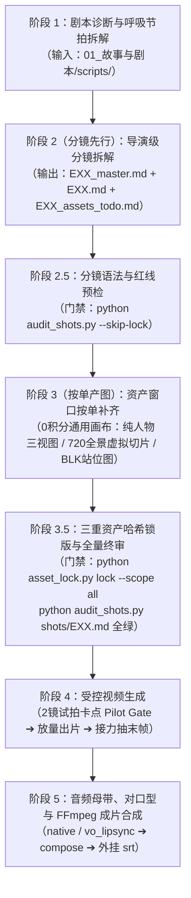

# AI 短剧工业化全流程规范、标准与模板全集（供 AI 架构评审与迭代优化专用版）

> **【使用说明】**：本文件汇编了当前项目（基于 `PIPELINE_SPEC v3.5` · Seedance 2.5 深度工程强化版）的**端到端全流程架构、多窗口职责分工、底层扩散机理、15 条去 AI 感硬性规范、标准资产与分镜模板、自动化门禁工具链及当前暴露的工程痛点**。
> 您可将本文档完整复制给其他高级 AI（如 Claude 3.7 Sonnet、GPT-4.5/o1、Gemini Pro 等），作为背景底料，让其开展架构审查（Architecture Review）、找漏洞、做减法、精简冗余、优化执行流并修复现存小问题。

---

## 0. 给评审 AI 的系统提示词与评审任务（Prompt for Reviewer AI）

```text
你是一位深耕生成式视频（Video Diffusion Models，特别是 Seedance 2.5 / 即梦通用画布 / Kling / Sora）、传统影视视听语言（分镜/摄影/剪辑/表演动力学）以及工业化软件流水线（CI/CD、职责隔离、自动化门禁）的资深架构师兼电影导演。

请仔细阅读以下《AI 短剧工业化全流程规范、标准与模板全集》。该体系旨在建立一套“分镜先行、按单产图、0 积分通用画布闭环、纯物理去 AI 感”的影视工业级生产管线。
但在实际落地与生产实操中，我们发现依然存在不少摩擦力、小问题和潜在缺陷。

请你作为独立的第三方专家，针对本规范执行深度评审，重点对以下维度提供切实可行的改良方案：
1. 【提示词工程与注意力稀释】：8 大补偿层与生理机理翻译导致单镜字数较长（通常在 300–600 字）。在 Seedance 2.5 等模型的实际表现中，文本过长是否会导致前后语义稀释（Attention Dilution）或漏指令？如何实现“高信息密度却轻量简短”的黄金提示词骨架？
2. 【白模人偶颜色与材质溢出风险】：站位图（BLK）使用纯亮橙色、深蓝色哑光人偶，尽管有解耦条款，在极端光影下仍偶尔发生“人脸被染上橙色/蓝色”或“出现塑料假人质感”。如何从 Prompt 结构、负向约束或图源处理上更彻底地根除颜色和材质渗透？
3. 【复杂动态与运镜的连贯性】：当前 720° VR 全景提取四机位解决了固定机位空间一致性，但在遇到大幅度推拉摇移、升降甩镜或追逐打斗时，静态切片参考图往往约束不住大动量。如何设计平滑过渡方案？
4. 【多窗口协作与工序断点】：目前依靠人脑在窗口①（剧本）、窗口③（分镜）、窗口②（资产）、窗口④（视频）之间手动传递派单表和门禁命令。如何进一步精简工序，避免人工反复复制粘贴的漏错？
5. 【音频口型与成片合成工程】：native 模式（模型自生人声）与 vo_lipsync（外挂对口型）的衔接细节，如何更好地平衡台词时长、生理气口与后期合成效率？
6. 【过度工程化识别与裁剪】：指出本规范中有哪些条目是“理论很美好但实际模型根本听不懂/执行不了”的过度设计（Over-engineering），帮我们做减法。
```

---

## 一、 端到端 5 阶段标准生产工作流（分镜先行 · 按单产图）



### 1.1 核心流程原则
1. **分镜先行、按单产图、锁版后开拍**：
   - 严禁在没有资产派单表时盲抽资产；严禁在资产未锁版时盲抽文生视频（T2V）。
   - 每集先由【窗口③ 分镜】通读剧本，拆解出分镜正文与《本集资产需求派单表》（`shots/EXX_assets_todo.md`），并通过 `--skip-lock` 分镜预检；
   - 再由【窗口② 资产】按单补齐缺失的角色、场景、站位图，通过 `audit_cast.py` 预检后执行 `asset_lock.py lock --scope all` 锁定 SHA-256 哈希；
   - 最终全量跑通 `audit_shots.py shots/EXX.md` 绿灯放行，移交【窗口④ 视频】开拍。
2. **0 积分通用画布闭环（省钱与防资产漂移）**：
   - 所有图片资产（三视图、变体、场景、720 全景、白模站位图）统一走 `dreamina-canvas` CLI，不走短剧画布；
   - **闭环逻辑**：CLI 创建图片节点写入提示词（不加 `--run`，0 积分）➔ 用户在网页端开启「0积分畅用」点击一键生成 ➔ CLI 使用 `resource download` 下载入库 ➔ 运行工具锁版。

---

## 二、 多窗口目录职责与读写边界说明书（`WORKSPACE_MAP`）

为了实现多 Agent / 多对话窗口协同不踩踏，定义以下 5 大工种窗口及严格的目录权限边界：

| 窗口编号与工种 | 管辖目录 | 权限 | 核心职责与产出物 | 严禁事项（红线） |
| :--- | :--- | :--- | :--- | :--- |
| **窗口①：剧本策划** | `01_故事与剧本/` | **专属写入** | 维护世界观圣经、大纲、逐集剧本（`scripts/第XX集_<标题>.md`） | 其他窗口严格只读；禁止越权修改剧本原文 |
| **窗口③：导演分镜** | `shots/` | **专属写入** | 剧本解析、输出 13 列总控表 `EXX_master.md`、Seedance 2.5 即粘正文 `EXX.md`、派单表 `EXX_assets_todo.md` | 严禁正文出现 `镜头/camera/lens`、字面染色、BGM；分镜未过预检不准移交 |
| **窗口②：资产生产** | `cast/`（含 `blocking/`, `frames/`, `canon/`） | **专属写入** | 按派单表生产纯空手三视图、720全景投影切片、彩色白模站位图、Mode A 首帧定姿图；全量 SHA-256 锁版 | 严禁角色基础三视图带武器/背包；严禁静默覆盖已锁版资产；改动必须走变更流 |
| **窗口④：视频与合成** | `out/`（及从过审视频抽末帧入 `cast/frames/`） | **专属写入** | 跑预检、2 镜试拍卡点、放量出片、抽无损末帧接力、配音口型对齐、成片合成 `out/EXX.mp4`、维护 `RUNLOG.md` | `RUNLOG.md` 只追加不修改；单集 80% 预算熔断；单镜最多 3 次尝试（每次只改 1 个变量） |
| **窗口⑤：总控与规范** | `02_规范与工具/`, `AGENTS.md`, `README.md` | **专属写入** | 规范迭代（旧版归档 `old/`）、维护 Python 自动化门禁脚本、跨集典范变更审核 | 业务窗口禁止私自篡改或放宽门禁拦截规则 |

### 跨窗口防踩踏 3 条铁律：
1. **同一时间同一目录只允许一个窗口写入**；
2. **禁止越权修改上游文件**（分镜发现台词问题只提建议，不改剧本；视频发现资产问题只挂起并交回资产窗口走三步变更流）；
3. **分镜先行，按单生产**（严禁无派单表盲抽资产）。

---

## 三、 底层扩散机理与五大根因诊断（Root-Cause Diagnosis）

针对 AI 视频模型的核心翻车痛点，本规范基于视频扩散模型（Video Diffusion）底层数学机理制定的治本对策：

### 1. 冰冻木偶与死亡世界（Frozen Puppets & Dead World）
- **机理**：去噪扩散优先收敛于时序一致性最高、代价最低的极值解——“静止”。只有带有显式动态动词（Motion Verbs）的 Token 才能获得交叉注意力权重。说话人面部词汇密度高，注意力集中在嘴部；听者与背景无动词描述，默认继承静态先验被冻结为蜡像。
- **治本对策（三层动态环境预算 + 听者物理待机库）**：
  - **前景待机层（Foreground Idle）**：听者或未发力角色必须分配显式待机微动作（指尖轻叩、胸膛呼吸起伏、重心换脚、缓慢眨眼）；
  - **中景物理层（Midground）**：次要人物移动、道具受力微动、衣摆甩动、蒸汽/火星；
  - **背景介质层（Background）**：天气流动（雨滴划窗、暴风摇树）、光影突变（霓虹微烁、闪电划过）、空气悬浮微粒（丁达尔尘埃）。
  - **连续 vs 突变**：每层至少含一个连续运动和一个偶然突变（如水滴跌落），打破死板循环。**严禁写“在听 / 站着不动”**。

### 2. 字面染色与文本广播谬误（Literal Dyeing）
- **机理**：CLIP / T5 文本编码器会将颜色与状态修饰词直接绑定到临近名词，并广播至该实体的全部生成区域。写“脸红”会被直接渲染为“全脸涂抹红油漆”；写“眼前发黑”会导致画面曝光归零（黑屏）；写“咬牙切齿/冷汗”会召回极端夸张的二次元/恐怖片纹理。
- **治本对策（生理机理翻译层 The Physiological Translation Layer）**：
  - 将成语/抽象情绪翻译为**三元组物理通道**：
    1. **具体生理机理（Mechanism）**：肌肉收缩、瞳孔变化、呼吸节律、下颌受力；
    2. **局部区域与微度（Locality & Degree）**：“颧骨与耳尖隐约泛起极微弱红晕”；
    3. **保真条款（Preservation Clause）**：“面部其余区域保持自然健康肤色，无全局调色漂移”。
  - **正面描述优先**：只写所见，避免“不要红脸/不要黑屏”等否定句（否定词仍会激活对应颜色 Token）。

### 3. 蜂群同质化（Synchronized Hive-Mind）
- **机理**：集合名词（如“众人低头”、“大家吓了一跳”）作为单一条件广播给所有人物实例，导致所有人动作、振幅、速度完全同步，呈现机器人感。
- **治本对策（站位槽位切分与错峰启动）**：
  - 严禁集合动词，按画面槽位（≤3人）逐一命名分工（“左侧角色A”、“右侧角色B”）；
  - 设定不同的**启动延迟时间差（Onset Offset，如 +0.0s、+0.8s、+1.6s）**、动作振幅与速度；
  - 必须保留至少 1 人反应慢半拍或无反应，体现现实非对称性。

### 4. 肢体融化、缺乏惯性与对讲机式对白
- **机理**：单镜头关节自由度过多导致潜在空间塌陷融化；只写动作峰值导致动作缺乏预兆且突发截断；轮流说话导致像对讲机通话。
- **治本对策**：
  - **统一动作预算**：每 5 秒仅容纳 1 个主动作 + 1 个次要动作 + 环境微动；
  - **三拍子动词（Three-Beat Verbs）**：蓄力起势 (Anticipation 0.5–0.8s) ➔ 动作冲量 (Action) ➔ 撞击锁死与惯性衰减 (Settle & Follow-Through)，必须交代终态姿势；
  - **对白打破对讲机**：听者在对方开口前 0.5s 先产生生理反应，允许动作打断与自然留白。

### 5. 漂浮幻灯片综合征与匀速失重感（Floating Slideshow Syndrome）
- **机理**：视频扩散模型默认采用均匀线性插值计算帧间潜变量，若无动力学冲击量与阻尼描述，模型默认匀速运动，呈现失重漂浮感；全集镜头若均为均等时长（如机械的每镜 5 秒），将抹杀视听呼吸。
- **治本对策（呼吸式动力学架构）**：
  - **宏观呼吸节拍波（Macro Cadence Wave）**：
    - **吸气蓄势拍（Inhale）**：`4.0–6.0 秒`，静态机位或极缓推，维持凝固张力；
    - **呼气爆发拍（Exhale）**：`1.5–3.0 秒`，短促疾速爆发、集中动能冲击、0 浪费帧；
    - **屏息沉降拍（Hold）**：`4.0–6.0 秒`，动作落地锁死、尘埃微粒沉降、呼吸喘息余韵。
  - **微观非线性缓动**：蓄力（质心下沉/微停顿）➔ 爆发 ➔ 撞击锁死与惯性过冲衰减；
  - **动态反差不对称**：主体静止时拉满环境动态；主体剧烈运动时，锁定机位绝对基座，放大相对速度与冲击力。

---

## 四、 15 条导演级去 AI 感硬性规范与两大核心词典

### 4.1 摄影机禁用词与替换表
所有分镜提交正文**严禁出现 `camera`、`lens`、`镜头` 三词**（预检直接拦截）：
- `镜头推进` ➔ `画面平滑推进 / 视点缓慢前移`
- `固定镜头` ➔ `固定机位 / 静止画面`
- `绝不看镜头` ➔ `视线死锁窗框外的远山 / 眼神紧盯手中扳手齿口`

### 4.2 生理机理翻译标准词典（规避字面染色与抽象情绪词）

| 剧本成语/情绪 | 严禁写法（字面染色翻车） | 标准物理降维翻译写法（机理 + 局部微度 + 肤色保真条款） |
| :--- | :--- | :--- |
| **害羞 / 脸红** | 脸红了、脸颊涨红 | 颧骨高处与耳尖微泛极淡微温红晕，缓慢浮现。面部其余区域保持自然健康肤色不变，无全局调色漂移。视线微向下垂，下颌微收。 |
| **恐惧 / 脸色煞白** | 吓得脸色惨白、面无血色 | 面部神态骤然凝固，眨眼停滞，嘴唇紧抿泛平，鼻翼微张屏息片刻后微弱浅呼吸。面部保持自然肤色与均匀光影，无曝光突变。 |
| **眩晕 / 眼前发黑** | 眼前一黑、头晕目眩 | 双眼极缓慢长眨一次，背景焦点微向后虚化失焦，单手急促撑住最近的坚固物体表面，身体质心轻微晃动后稳住。画面整体曝光保持不变。 |
| **咬牙切齿 / 恨极** | 咬牙切齿、面目狰狞 | 咬肌在下颌转折处骤然绷紧隆起，双唇始终自然紧闭，鼻翼微张微颤。口腔与面部轮廓保持自然生理结构。 |
| **冷汗直冒** | 额头满是冷汗、大汗淋漓 | 太阳穴处隐约凝结一颗微小汗珠并在光下泛出微弱高光，喉结微弱上下滚动一次。面部皮肤肌理与质感保持自然洁净。 |
| **心沉谷底 / 绝望** | 心沉了下去、心碎绝望 | 双肩极细微向下沉落两厘米，鼻腔极缓慢呼出一口长气，双眼视线无焦点下落。神情静止凝滞。 |
| **暴怒 / 怒火中烧** | 暴怒、怒目圆睁、浑身发抖 | 仅右手五指产生极其细微的克制紧绷颤抖，握持物体的指节轻微发白，声音低沉平缓，双肩锁死不动。 |
| **群体羞愧 / 尴尬** | 众人都感到很羞愧 | 依站位分配给 2–3 名具名角色不同微动作：左侧角色视线偏转向下，右侧角色抬手微扯衣角，错峰间隔 0.8 秒启动；至少 1 人毫无动作。 |
| **热泪盈眶** | 泪流满面、号啕大哭 | 下眼睑边缘泛起微弱湿润水光，缓慢眨眼一次，仅有一滴悬而未决的泪水凝在睫毛末梢、未曾滚落。眼神保持稳定清亮。 |

### 4.3 非线性动力学与缓动词典（规避匀速与失重漂浮）

| 动力学动作意图 | 严禁写法（匀速漂浮慢动作） | 标准非线性缓动与惯性过冲翻译写法 |
| :--- | :--- | :--- |
| **骤然伸手 / 抓取** | 伸手抓起桌上的票据 | 指尖在裤袋边缘悬停顿挫 0.5 秒（蓄力），随即右手以骤加加速度向前疾探，五指精准扣紧硬质票据表面并骤然锁死静止；冲锋衣袖口因惯性向前滑窜后自然回落服帖。 |
| **猛烈回头 / 警觉转头** | 转过头看向她 | 视线在前方死锁半拍（蓄力），随后头部以极高角速度猛烈甩向画面右侧画外目标方位；耳际发梢因惯性轻微向外过冲甩动，随后迅速回弹并阻尼落定锁死，眼神凝固。 |
| **霍然起身 / 拍案起立** | 从椅子上站起来 | 双手手掌平平撑在木桌边缘，上身微向前倾压低质心（蓄力），随后双臂与腰腹骤然爆发向上挺起，身躯霍然拔直站立；衣摆与腰带因惯性向前剧烈甩动，晃荡两次后渐止服帖。 |
| **重击 / 拍桌 / 怒砸** | 挥拳砸在桌子上 | 前臂向上抬起并在空中短暂悬停半拍（蓄力），紧接着右拳以极高速度垂直下砸；指节重重砸击在厚木台面并瞬间冲击锁死不动；周围台面细微浮尘震荡扬起，小工具产生微弱跳跃碰撞声。 |
| **骤然僵死 / 突发震惊** | 听到声音停下动作，很震惊 | 正在作业的右手在半空中瞬间绝对刹车锁死；吸气骤然卡在喉头，双肩肌肉完全绷紧僵固；腰间悬挂的细小金属挂件因惯性继续产生轻微残留晃动，逐渐衰减至静止。 |

### 4.4 15 条导演级硬性规范完整列表
1. **绝对视线锚点**：严禁写“看着对方”，严禁写“正视前方/直视前方/面向正前方/看向观众”，必须锁定具体画内实物或偏角方位。
2. **打破对讲机对话**：听者在发言前 0.5 秒先产生生理反应；善用环境声响阻断对白。
3. **生理机理翻译**：全面消除抽象强情绪词与字面染色。
4. **手部实物绑定**：手部必须与具体工具、布料或身体接触锚定，消除无意义悬空抖动。
5. **统一动作预算与非线性动力学**：单拍 2–4 秒仅容纳 1 个主动作；打斗/翻滚硬上限 ≤2 秒；爆发动作必写蓄力与惯性终态。
6. **默认正向描述，严禁滥贴排除词**：默认不写 `Exclusions:`，严禁批量复制未经实测的 `文字, 水印, 边框`。
7. **双模式实体规范**：
   - Mode B（多参考图 ≤4 张）：正文统一使用 `@别名`（如 `@场景`、`@角色A`）；
   - Mode A（首尾帧 I2V）：仅挂首帧，正文用纯角色名，严禁出现任何 `@别名`。
8. **宏观呼吸节拍波（Cadence Wave）**：1.5–3.0s 爆发 vs 4.0–6.0s 蓄势与余韵，严禁均长剪辑。
9. **三层景深与分层走位**：多实体同框必须划分近/中/远层与物理间距（如“相隔两米泥地”）。
10. **单一主光源与空气介质**：继承场景底图主光，写入具体空气介质（雨丝、浮尘、冷雾）。
11. **自然微瑕疵纹理**：强调布料折痕、泥浆飞溅、金属磨损，杜绝空洞的 `masterpiece, 8k`。
12. **规避高穿模姿态与柔性物件惯性**：回避交叉双臂与十指相扣；发辫、衣摆必须注明惯性甩动方向。
13. **服装关键材质锚点**：每镜正向强化 1–2 处关键材质（金属拉链反光、铜扣），作为抽帧质检核心锚点。
14. **全物理声源，严禁 BGM**：所有音效使用 `<物理声源音效>` 标注且可物理溯源；Prompt 严禁写 `BGM/配乐/music/score`。
15. **全员在场闭环**：总控表中每镜必须完整标注所有角色的在场状态（🎬出镜 / 👂画外存在 / ❌合理不在场），不漏标，不出现 ⚠️。
16. **画面绝不烧录字幕（特别铁律）**：每镜提示词末尾逐字声明「不要生成旁白字幕、台词字幕或对白字幕。」台词仅用于生成口型和人声，成片字幕统一由阶段 5 挂载外置 `srt`。

---

## 五、 资产分类、标准编号体系与两大工程解决方案

### 5.1 资产编号体系（Asset Taxonomy）

| 资产编号代码 | 资产类型说明 | 核心用途与约束 | 存储路径范例 |
| :--- | :--- | :--- | :--- |
| **`CHR-<name>-TURN`** | 纯人物空手基础三视图 | 锁定面部骨相、五官、体格、基础服装；**严守空手无道具铁律**，双手自然垂于体侧 | `cast/<角色>.默认.png` |
| **`CHR-<name>-EXP`** | 表情与微反应锚点卡 | 锁定关键情绪结构，保持自然肤色，无字面染色 | `cast/<角色>.<表情>.png` |
| **`CHR-<name>-STATE`** | 特殊状态/换装/战损卡 | 剧情触发的泥泞、撕裂、伤痕装，**必须由基础三视图直接派生** | `cast/<角色>.<战损态>.png` |
| **`SCN-<place>-MASTER`** | 场景主控空镜图 | 物理空间布局、地貌、陈设与唯一主光；**严禁出现人物** | `cast/<场景>.默认.png` |
| **`SCN-<place>-GRID`** | 场景多机位四宫格展板 | 720 全景切片拼接的 16:9 四联纯净展板（反打/俯视/左侧/右侧，**严禁含任何文字说明**） | `cast/<场景>.多机位展板.png` |
| **`SCN-<place>-ANGLE-x`** | 场景特定机位切片 | 保持布光一致的反向视点或关键作业区（由全景工具自动投影切出） | `cast/<场景>.机位_<名>.png` |
| **`PRP-<item>`** | 核心信物与道具特写卡 | 1:1 或 16:9 中性灰底孤立特写，两角度展示，确定材质质感与磨损 | `cast/<道具>.默认.png` |
| **`LIT-<scene>`** | 空间光影基调参考 | 主光源色温、反差比与空气介质调性 | `cast/<场景>.光影基调.png` |
| **`BLK-<EXX>-<SXX>`** | 单镜彩色白模人偶站位图 | 极简 3D 灰模空间，确定单镜机位构图、透视与多人空间站位 | `cast/blocking/EXX_SXX_blocking.png`|
| **`FRM-<EXX>-<SXX>`** | 动态首尾定姿帧与接力帧 | 模式 A 专用，关键物理瞬间定姿图或上镜过审视频 100% 原画质末帧 | `cast/frames/EXX_SXX_first.png` |

- **规则 P-1（挂载作用域隔离）**：仅 `cast/`、`cast/frames/` 与 `cast/blocking/` 允许挂给视频模型；`cast/storyboard/`（导演台、分镜草图）仅供人眼看，严禁挂载。
- **规则 P-3（一角一源）**：单镜内每个角色最多绑定 1 个图源（启用派生变体卡时直接替换基础卡，严禁二者并存）。

---

### 5.2 解决方案 A：720° VR 全景虚拟切片体系（废除 2D 文本生成场景四宫格）

- **痛点机理**：2D 扩散模型无 3D 几何引擎，纯文字生成的四宫格场景图，四个格子的门窗、桌椅、布光各自独立变形，机位完全对不上。
- **工业解法**：
  1. 通用画布基于场景主图生成 **720° 球形等距柱状全景图（`SCN-*-PANO` · `cast/<场景>.全景720.png`）**；
  2. 运行本地全自动切片工具 `pano_to_grid.py`，2 秒内依据三维球面投影数学模型无损提取 4 大 16:9 机位并拼合为纯净四宫格展板：
     - **反打机位**：`--yaw 180 --pitch 0` ➔ `cast/<场景>.机位_反打.png`（看大门与入口）
     - **俯视机位**：`--yaw 0 --pitch -50 --fov 90` ➔ `cast/<场景>.机位_俯视.png`（俯瞰全场）
     - **左侧机位**：`--yaw -90 --pitch 0` ➔ `cast/<场景>.机位_左侧.png`（看左墙）
     - **右侧机位**：`--yaw 90 --pitch 0` ➔ `cast/<场景>.机位_右侧.png`（看右墙）
     - **四宫格展板**：`cast/<场景>.多机位展板.png`（100% 纯净无文字标牌）。

---

### 5.3 解决方案 B：彩色白模人偶站位图系统（`BLK-<EXX>-<SXX>`）

- **痛点机理**：单纯依靠文本描述（“A在左，B在右”）无法约束多人在复杂场景中的透视和纵深关系；若在站位图中使用复杂写实场景，会与 `@场景` 母卡打架产生特征争抢，导致背景形变。
- **工业解法（极简 3D 预演空间与三权分立解耦）**：
  1. **极简 3D 灰模空间**：纯净中性浅灰三维摄影棚，地面带微弱透视网格线，障碍物仅用浅灰长方体几何块示意，**绝无真实墙面纹理与陈设**；
  2. **纯色彩色无脸人偶**：纯色哑光人偶，无五官、无毛发、无真实衣物，仅展现体块姿态与高矮；全剧固化色彩绑定：
     - 主角A：**纯亮橙色人偶**
     - 主角B/核心配角：**纯深蓝色人偶**
     - 女主/敏捷型角色：**纯翠绿色人偶**
     - 长辈/反派：**纯深赭石色人偶**
     - 路人/群演：**纯浅灰色人偶**
  3. **三权分立解耦（Three Pillars of Authority）**：
     - `@场景` ➔ 独占空间结构、墙面纹理、陈设细节、主光与天气介质；
     - `@站位图` ➔ 独占机位构图、透视景深、人物三维坐标、骨骼姿态与视线轴线；
     - `@角色` ➔ 独占真实人类五官、皮肤毛孔肌理与真实织物纤维；
     - **正向防漏约束**：提示词中明确映射「橙色人偶对应@角色A」，并声明「全场环境完全以 @场景 材质布光渲染，所有出镜角色呈现真实人类皮肤与生动五官，服装为真实织物。站位图只提供坐标、透视与姿态」。

---

## 六、 全套标准提示词模板（Templates 01 ~ 05）

### 模板 01：角色三视图模板（`01_角色三视图_模板.md`）

````markdown
# <<角色名>>

## 设定
- 分级：<<主角 / 核心配角 / 反派>>
- 出场集：<<如：第 1–80 集>>
- 生理年龄与体格：<<如：22 岁男性，身高 178cm，精干挺拔>>
- 外观白描（纯人物基础态，严禁任何武器/背包/书本等外挂道具）：<<骨相、五官比例、瞳色、肤色、发型、基础服装材质与磨损>>
- 身份标记：<<全剧绝对不变的 2–3 个纯人物与基础服饰特征>>
- 造型清单：默认（纯人物空手基础三视图） / <<派生形态：如 持械装备态、泥泞受惊态>>

## 默认（纯人物空手基础三视图 · CHR-<name>-TURN）

国漫3D（CG）写实高精度风格，电影级光影质感，顶级3D动漫电影渲染级别，人物解剖结构严谨自然，真实皮肤毛孔与织物纤维质感。

<<角色名>>，<<性别>>，真实视觉年龄 <<年龄>> 岁，<<身高与体格>>。面部骨相与五官：<<骨相、五官比例、瞳色、肤色、沉静自然神态>>。发型：<<发型与发色细节>>。基础服装穿戴：<<仅描述贴身上衣、下装、鞋履的色彩、面料肌理、关键材质扣件与磨损细节>>。双臂自然垂于体侧，双手完全空手放松，全身轮廓完整舒展。写实高精度3D动画电影纯人物基础主控资产渲染。

角色三视图设计展板，16:9 横版三联全身展示，同比例并排对齐：左侧为全身正面自然立姿，中间为严格 90 度正侧面完整轮廓，右侧为全身背面完整舒展体态（背部与体侧轮廓完全清晰露出）。干净中性深灰色摄影棚纯色背景，画面洁净纯粹，仅展示人物本体。

均匀细腻的写实漫反射影棚柔光，真实自然皮肤细微毛孔与轻微光泽，服装织物经纬肌理、真实自然折痕、金属扣件微弱反光与磨损细节清晰可辨。

角色身份核心标记：<<2–3 个纯人物与基础服饰特征（不含武器、背包、书本等外挂道具）>>。

## <<派生形态名：如 持械态 / 背负装备态 / 泥泞受惊态>>

<!-- 派生形态必须挂载纯净基础三视图：--ref <<角色名>>=file:cast/<<角色名>>.默认.png -->

国漫3D（CG）写实高精度风格，电影级光影质感，顶级3D动漫电影渲染级别，人物解剖结构严谨自然，真实皮肤毛孔与织物纤维质感。

是同一角色的基础形象，本图仍是同一个人。严格保留其骨相、五官比例、瞳色、肤色、体型与身份标记；只把以下部分换成当前形态：<<精准描述新增装备、持握道具或战损表情变化，如：右手握持红羽骨角矛 / 背负黑色防水双肩包且左手抱泛黄手册 / 冲锋衣沾满黑泥与松针>>。上文未提及部分与基础形象完全一致。

写实高精度3D动画电影角色派生形态定妆渲染，浅景深电影级光影，自然微瑕疵质感。
````

---

### 模板 02：场景与 720 全景模板（`02_场景与720全景_模板.md`）

````markdown
# <<场景名>>

## 设定
- 空间类型：<<室内封闭 / 室外开放 / 半开放洞穴>>
- 时代与地貌：<<如：现代城中村 / 公元前8000年全新世早期红松林>>
- 基准色调与光影：<<如：廉价昏黄白炽灯 vs 窗外冷白闪电>>
- 空间锚点清单（供分镜固定引用）：
  - 正面锚点：<<如：堆满示波器与工具的旧木工作台>>
  - 左侧锚点：<<如：旧显像管电视铁架与招牌>>
  - 右侧/后方锚点：<<如：贴满小广告的铁卷帘门 / 暴雨大窗>>

## 默认（场景主视图 · SCN-<place>-MASTER）

国漫3D（CG）写实高精度风格，电影级光影质感，顶级3D动漫电影渲染级别，真实物理材质与自然微瑕疵纹理，强明暗情绪反差，浅景深与空气介质微尘感。

<<时代与地点>>的<<场景名称>>宽银幕建立镜头全景。<<空间结构、建筑或地貌形态、地面材质与杂物细节、核心焦点陈设的精确方位>>。<<天气与空气介质：如暴雨倾盆、空气悬浮微尘、冷雾丁达尔光束>>。<<唯一情绪主光源方向与冷暖明暗反差描述>>。

电影级广角空间构图，三层清晰景深层次，纯环境空镜，画面中没有任何人物出现，无文字水印。

## 全景720（场景 360°×180° 球形母版 · SCN-<place>-PANO）

国漫3D（CG）写实高精度风格，电影级光影质感，顶级3D动漫电影渲染级别，真实物理材质与自然微瑕疵纹理。

基于{{主视图}}的场景设定，生成标准360度等距柱状全景图（Equirectangular projection panorama），720 VR球形全景环视视野，4K超高清分辨率。从空间中心向四周360度无缝展开：正前方为<<正面核心陈设>>，左侧为<<左侧结构>>，右侧为<<右侧结构>>，后方为<<后方结构>>，顶部天花板/天空与底部地面完整闭合，呈现自然球形透视弯曲。纯环境空镜，无人出现。

## 本地切片指令（生成四宫格展板与4大机位切片）
```bash
python 02_规范与工具/tools/pano_to_grid.py --input cast/<<场景名>>.全景720.png
python 02_规范与工具/tools/asset_lock.py lock --scope cast --reason "锁定全景切片"
```
````

---

### 模板 03：道具与猛兽设定模板（`03_道具与猛兽_模板.md`）

````markdown
# <<道具或生物名>>

## 设定
- 类型：<<核心道具 / 猛兽生物>>
- 出场集：<<如：第 1-3 集>>
- 核心剧情功能：<<如：引发雷击穿越的核心机关 / 压迫主角的史前顶级掠食者>>
- 外观与材质白描：<<尺度大小、机械或解剖结构、破损油污血迹等自然瑕疵>>

## 默认（PRP-<item>）

国漫3D（CG）写实高精度风格，电影级光影质感，顶级3D动漫电影渲染级别，真实物理材质与自然微瑕疵纹理，强明暗情绪反差，浅景深与空气介质微尘感。

<<道具或生物的精确名称与尺度规格>>高精度特写设定展板。<<主体结构、材质细节（金属锈蚀、铜线焊点、兽骨纹路、厚实毛发肌肉解剖）、使用磨损与真实瑕疵>>。<<情绪光影勾勒边缘轮廓，突出厚重工业感或蛮荒凶煞感>>。

干净深灰色中性摄影棚展板背景，主体单独居中，四周只有展板底色。
````

---

### 模板 04：导演级分镜拆解模板（`04_导演级分镜_模板.md`）

每镜由「2 行元数据卡头」+「纯净 `text` 代码块」组成，代码块可全选直粘至 Seedance 2.5 通用画布或网页端。

#### 1. Mode B（多参考图 · 挂载彩色白模站位图）

````markdown
## S01
- **参数**：`Seedance 2.5` ｜ `Mode B（多参考图·含极简白模站位图）` ｜ `16:9` ｜ `4.0s` ｜ `Audio: native` ｜ `Cadence: Inhale`
- **挂载参考图（≤4张）**：`@工坊`=`cast/工坊.默认.png` ｜ `@站位图`=`cast/blocking/E01_S01_blocking.png` ｜ `@角色A`=`cast/角色A.默认.png` ｜ `@角色B`=`cast/角色B.默认.png`

```text
国漫3D（CG）写实高精度风格，电影级光影质感，顶级3D动漫电影渲染级别，真实物理材质与自然微瑕疵纹理，强明暗情绪反差，浅景深与空气介质微尘感。

参考映射与三权解耦：
@工坊 为全场唯一的真实场景空间结构、陈设纹理与光影材质基准；
@站位图 为极简 3D 白模空间透视与人物走位基准（只取空间坐标、机位透视与人偶骨骼姿态，浅灰网格与几何体块留在参考图里）；
@站位图 中的【纯亮橙色人偶】对应 @角色A，【纯深蓝色人偶】对应 @角色B；
@角色A 为角色真实人类生理与服装材质基准（将橙色人偶完全替换为真实人类形态：真实细腻皮肤毛孔肌理、生动五官神态、亮橙色冲锋衣真实布料）；
@角色B 为角色真实人类生理与服装材质基准（将蓝色人偶完全替换为真实人类形态：真实人类肤色、沉静神情、深色工装围裙材质与机油纹理）。
本片段设定在 @工坊。桌面散落机械零件与冷光油污，窗外暴雨如注。整体基调：暖黄工作台吊灯与冷蓝窗外雷雨形成强烈冷暖对冲，中景微弱景深虚化。

拍子1（0.0–2.0秒）：中景双人过肩视点，机位固定静止。@角色B 位于画面右侧近景背对画面侧身，视线死死聚焦在工作台上，胸膛随呼吸起伏，指尖轻叩台沿；@角色A 位于左侧中景台前，双手撑在桌沿身体微前倾压低质心（蓄力），指节微弱发白；深色冲锋衣带着真实织物折痕。窗外暴雨沿窗玻璃不规则流淌，吊灯光柱中悬浮细微尘埃。<工作台零件轻微金属碰撞声与窗外沉闷雷雨声>
拍子2（2.0–4.0秒）：画面平滑微距推进。@角色A 猛然直起身躯挺直站立，衣摆因惯性向前甩动随后回落服帖（终态锁死）；面部颧骨处保持自然微黄肤色与健康光泽，无调色漂移，开口低沉说道：「零件全被动过了。」<木桌受力摩擦声与低沉呼吸声>

全场环境完全以 @工坊 的写实材质与布光渲染，所有出镜角色呈现真实人类皮肤肌理与生动五官，服装是真实织物。站位图只提供坐标、透视与骨骼姿态。音轨仅保留角色人声、环境声与物理动作音效；画面中所有出镜角色动作稳定自然。不要生成旁白字幕、台词字幕或对白字幕。
衔接：角色A站立于桌前，右手仍按在台面边缘。
```
````

#### 2. Mode A（首尾帧 I2V · 纯角色名）

````markdown
## S02
- **参数**：`Seedance 2.5` ｜ `Mode A（首尾帧 I2V）` ｜ `16:9` ｜ `2.5s` ｜ `Audio: native` ｜ `Cadence: Exhale (Burst)`
- **挂载首帧（不挂其他参考图）**：`首帧`=`cast/frames/E01_S02_first.png`

```text
国漫3D（CG）写实高精度风格，电影级光影质感，顶级3D动漫电影渲染级别，真实物理材质与自然微瑕疵纹理，强明暗情绪反差，浅景深与空气介质微尘感。

紧接首帧画面直接延续动作。泥泞林地，暴雨如注，空气中弥漫飞溅雨雾与湿冷水汽。
拍子1（0.0–1.2秒）：低机位仰角仰视，机位绝对固定锁死。角色A 维持首帧右腿弓步起势，脚下泥浆飞溅；双臂将长矛以极高加速度向前迅猛平刺破空而出，矛杆保持笔直刚性，红羽饰因惯性向后紧绷拉直。<矛尖破风锐啸声与脚下泥泞踩踏飞溅声>
拍子2（1.2–2.5秒）：矛尖猛烈凿入粗糙树干，双臂惯性前送并在伸直位骤然冲击锁死（终态姿态完全定住）；上衣布料在紧绷状态下骤停，衣摆因余震轻微向前颤动两次后落定服帖。树干震落大片雨水与松针。<沉重钝响撞击声与密集落叶水滴声>

画面中所有出镜角色全程不说话。音轨仅保留环境声与物理动作音效。不要生成旁白字幕、台词字幕或对白字幕。
衔接：角色A双手紧握矛杆维持刺入锁死姿态，胸膛剧烈喘息。
```
````

#### 3. 13 列分镜总控表格式（`shots/EXX_master.md`）

| Shot | Dur | Scene | Characters | Mode | Refs | Frame Status | Audio Mode | Emotion In → Out | Bridge | Cadence Beat | Deps | QC & Attempts |
| :--- | :--- | :--- | :--- | :--- | :--- | :--- | :--- | :--- | :--- | :--- | :--- | :--- |
| **S01** | 4.0 | 工坊 | 角色A 🎬；角色B 🎬 | B | `@工坊=cast/工坊.默认.png` `@站位图=cast/blocking/E01_S01_blocking.png` `@角色A=cast/角色A.默认.png` `@角色B=cast/角色B.默认.png` | Not Required | native | 专注→开口 | None | Inhale (4-6s) | cast/工坊.默认.png | 未检 / 0 |
| **S02** | 2.5 | 林地 | 角色A 🎬 | A | `首帧=cast/frames/E01_S02_first.png` | Mandatory | native | 蓄力→撞击 | None | Exhale (1.5-3s) | cast/frames/E01_S02_first.png | 未检 / 0 |

---

### 模板 05：极简三维彩色白模站位图模板（`05_彩色白模站位图_模板.md`）

````markdown
# 极简三维白模站位图提示词（BLK-E<<集数>>-S<<镜号>>）

## 基础设定
- 对应镜号：E<<集数>>_S<<镜号>>
- 对应场景空间轮廓：<<场景名，如：钟表维修铺 / 狭窄溶洞口>>
- 出镜人偶：主角A（纯亮橙色人偶）、主角B（纯深蓝色人偶）

## 生图执行提示词（通用画布图片节点 · 0积分畅用）

中性灰三维预演，均匀影棚柔光，浅灰几何体块与纯色哑光人偶，地面带透视网格，全景深，画面只有白模空间。

影视工业级 3D Previs 空间站位与机位走位白模渲染图，16:9 横版画幅。
预演空间环境（极简白模体块空间）：干净纯粹的中性浅灰色三维摄影棚预演空间（Minimalist 3D Whitebox Stage），地面带有微弱写实的透视参考网格线（Perspective Floor Grid）；空间中仅用极简无贴图的浅灰白模几何体块（Simple Clay Blocks / Bounding Boxes）示意基本空间结构：中央有一具无细节的长方体工作台白模、背景为极简长方形门框轮廓；背景完全洁净，无任何真实墙面纹理、无任何写实陈设贴图，杜绝视觉干扰。

画面机位与构图：中景双人过肩视点，固定机位平视，精准三维空间纵深与景深分层。
空间中精确放置 2 具纯色哑光光滑人体白模人偶素体（Solid Matte Color Mannequins，无眼耳口鼻五官、无毛发、无真实衣物细节，仅展现严谨人体结构骨骼、体块与动作姿态）：
1. 画面左侧中景为【纯亮橙色光滑人偶】（代表主角A，青年精干体型），姿态：双手撑在长方体桌沿身体微前倾，头部面朝右侧；
2. 画面右侧近景为【纯深蓝色光滑人偶】（代表配角B，魁梧健硕体型），姿态：背对画面侧身站立，左手下垂右手搭在方块边缘；
两具人偶相隔一米物理间距，视线与身体朝向明确形成对峙空间轴线关系。

中性漫反射影棚柔光，自然在极简白模与彩色人偶表面产生写实的高光与几何投影，构图严谨自然，电影级 3D 空间透视与走位基准参考板。
````

---

## 七、 自动化门禁工具链与校验规则

本系统在 `02_规范与工具/tools/` 固化了 Python 自动化脚本，充当工业流水线的 CI/CD 门禁：

### 1. `audit_shots.py`（分镜 17 项自动拦截）
- **拦截 1**：摄影机禁用词（不含 `camera`, `lens`, `镜头`）；
- **拦截 2**：未解析占位符清零（不含 `{{...}}`, `<<...>>`）；
- **拦截 3**：模式 B 别名闭环（正文 `@别名` 与卡头 Refs 一致）；
- **拦截 4**：模式 A 纯净度（只挂首帧，正文无 `@别名`，紧接首帧起句）；
- **拦截 5**：双模式互斥（同一镜不能既有首帧又有多参考图）；
- **拦截 6**：故事板隔离（路径严禁含 `storyboard/` 或 `.director.`）；
- **拦截 7**：拍子时间连续性（各拍总和等于 Dur，时长必须在 1.5–3.0s 或 4.0–6.0s）；
- **拦截 8**：台词硬上限（单句台词 ≤10 字，建议 ≤8 字）；
- **拦截 9**：无台词镜必须写「画面中所有出镜角色全程不说话。」且音轨禁写「角色人声」；
- **拦截 10**：每一个拍子必须含有 `<物理声源音效>`；
- **拦截 11**：绝对视线锚点（拦截 `正视前方`、`直视前方`、`看向观众`、`面向正前方`、`看着对方`）；
- **拦截 12**：生理机理翻译拦截（拦截 `暴怒`、`极度震惊`、`嚎叫`、`脸红`、`眼前发黑` 等）；
- **拦截 13**：严禁 BGM（拦截 `BGM`, `背景音乐`, `配乐`, `music`, `score`）；
- **拦截 14**：严禁滥贴排除词（默认不写 Exclusions，仅放行末尾「不要生成旁白字幕、台词字幕或对白字幕。」）；
- **拦截 15**：角色在场码检查（必须标注 🎬/👂/❌，不出现 ⚠️）；
- **拦截 16**：呼吸节拍波（满 3 镜不允许全同长，满 4 镜必须同时有短拍 1.5–3.0s 和长拍 4.0–6.0s）；
- **拦截 17**：锁版校验（不带 `--skip-lock` 时核验 SHA-256 哈希及磁盘存在性）。

### 2. `audit_cast.py`（资产卡提交前预检）
- 拦截基础三视图（`CHR-*-TURN`）误带武器、拐杖、背包、书本；
- 检查全片风格句是否一字不差；
- 拦截非纯色摄影棚描述。

### 3. `asset_lock.py`（全量 SHA-256 锁版机制）
- 写入并冻结 `cast/LOCKED.json`、`cast/frames/LOCKED_FRAMES.json`、`cast/blocking/LOCKED_BLOCKING.json`、`cast/canon/CANON.json`；
- 任何篡改或替换图片将触发 Hash Mismatch 阻断视频生成。

---

## 八、 试拍、质检与后期合成规程

1. **2 镜试拍卡点（Pilot Gate）**：
   放量出片前必须试拍 2 镜（1 镜室内微表情/对白 + 1 镜室外高速爆发），按 8 项指标人工验收（身份稳定、视线纪律、口型同步 ≤2 帧、物理穿模、动作终态锁死、180°轴线、材质锚点、景深分层）。
2. **接力帧无损抽取（`extract_last_frame.py`）**：
   视频过审后，运行工具抽取 100% 原始无损分辨率末帧作为下镜首帧，锁入 `LOCKED_FRAMES.json`。
3. **失败恢复阶梯与熔断**：
   - 尝试 1 失败 ➔ 仅改 1 个变量；
   - 尝试 2 失败 ➔ 改换另 1 个变量；
   - 尝试 3 失败 ➔ **禁止第 4 次盲抽**，必须拆分为更短镜头或转入 Mode A 首尾帧；
   - 单集达到 80% 积分预算立即熔断停机复盘；
   - 提交日志只追加录入 `out/EXX/RUNLOG.md`。
4. **成片合成**：
   - `Audio Mode` 区分：`native`（模型自生音轨） vs `vo_lipsync`（外挂配音对齐）；
   - 情绪跳跃处执行 0.5 秒音频淡化过渡桥（Bridge）；
   - 使用 `jimeng-novel compose` 组装成片，外挂 `EXX.srt` 字幕。

---

## 九、 当前已知的问题与痛点清单（供评审 AI 重点攻坚）

在当前管线试跑过程中，我们发现以下较为突出的“小问题”尚未完全根除，恳请提出针对性优化或替代方案：

1. **单镜提示词过长导致模型注意力稀释（Attention Dilution）**：
   - 包含了风格句 + 参考映射 + 场景环境 + 拍子1/2的动力学与生理机理 + 音轨约束 + 画面不烧字幕 + 衔接，总字数达 400–600 字。
   - **痛点表现**：Seedance 2.5 偶尔会漏掉后半段的动作或台词，或者对第一句风格句过度响应，对拍子2的动作视而不见。
   - **求助**：如何压缩冗余词汇，保留关键约束，设计出最适配该模型的高效 Prompt 结构？
2. **彩色白模站位图（BLK）的色彩与材质“渗透”（Color Bleed & Plastic Texture）**：
   - 虽然写明了三权解耦和“替换为真实人类”，但偶尔角色脸上或衣服上仍会染上一层微弱的橙色/蓝色光晕，甚至脸部骨骼略带塑料 mannequin 感。
   - **求助**：在不改变三维空间定位优势的前提下，是否有更好的站位图表现形式（如灰度线稿、骨骼骨架线、极淡纯色），或者更强的反渗透负向/正向提示词公式？
3. **全景投影四宫格在复杂运镜下的局限**：
   - 静态投影切出的反打/俯视机位图非常完美，但仅适用于固定机位或微小位移。如果剧本需要“高速穿梭运镜”或“绕角色360度旋转”，四机位参考图会显得僵硬。
   - **求助**：如何让机位切片参考图与大动态运镜更好地配合？
4. **多窗口协作的手动摩擦力**：
   - 目前窗口③拆出的《资产派单表》需要人工复制并唤起窗口②去通用画布操作，再人工拉回本地锁版。
   - **求助**：从流程调度或自动化脚本层面，如何提供更流畅的工序触发机制？
5. **台词字数与口型自然度的平衡**：
   - 尽管限制了单句 ≤10 字，但不同字词的开口度差异极大（如爆破音、元音），在 2.5–4 秒镜头内有时语速过急，有时口型提前闭合。
   - **求助**：在分镜拆解时，是否有更精细的音节/字数/气口计算标准？
